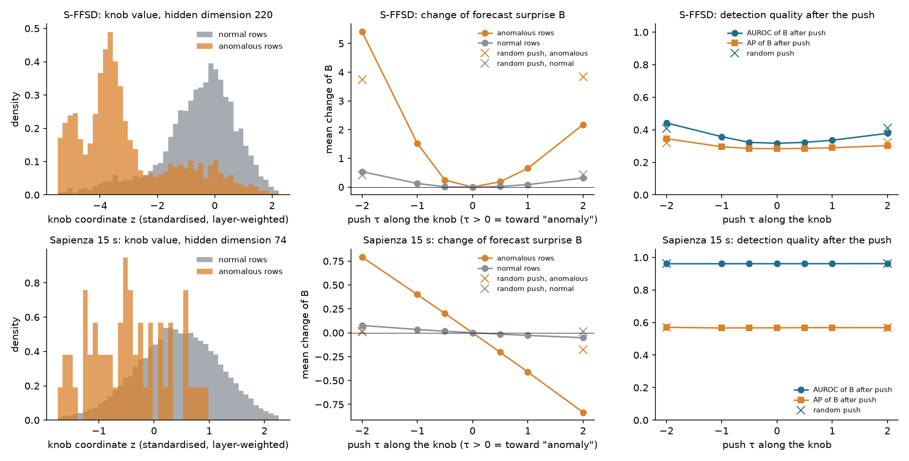

# What the knob's numbers mean, and which way to turn them

# 旋钮的数值是什么意思，应该往哪个方向调

Kronos-mini, real weights, S-FFSD and Sapienza 15 s. Script: `scripts/knob_values.py`. Results: `results/2026-11-16/knob_values/`.

Kronos-mini 真实权重，S-FFSD 与 Sapienza 15 秒。脚本：`scripts/knob_values.py`。结果：`results/2026-11-16/knob_values/`。



## 1. Short answer / 结论

**English.**

- **What the numbers are.** Kronos-mini keeps 256 internal numbers for each row. The knob is one of them on S-FFSD (number 220) and two on Sapienza (numbers 63 and 74). On both datasets a *lower* knob value means "more anomaly-like".
- **What they react to.** The knob is read *before* Kronos sees the row being scored, so it describes the 32 rows that came before. On S-FFSD it drops when the recent rows are a run of fraud. On Sapienza it drops when the minutes before the pump are already busier than usual.
- **Which way to turn it.** Turning the knob does not improve detection on either dataset. Pushing it toward "normal" (τ < 0) does raise the surprise on anomalies more than on normal rows, which is the right direction, but the effect is far too small to change which rows are flagged. The gain reported in this project comes from *reading* the knob as a second score, not from turning it.

**中文。**

- **这些数字是什么。** Kronos-mini 为每一行保留 256 个内部数字。旋钮在 S-FFSD 上是其中 1 个（第 220 个），在 Sapienza 上是其中 2 个（第 63、74 个）。两个数据集上都是旋钮值*越低*越像异常。
- **它们对什么有反应。** 旋钮是在 Kronos 看到被打分的那一行*之前*读出的，所以它描述的是前面 32 行。在 S-FFSD 上，最近的行是一串欺诈时它会下降；在 Sapienza 上，拉盘前的几分钟已经比平时活跃时它会下降。
- **往哪个方向调。** 在两个数据集上，转动旋钮都不能提高检测效果。把它推向“正常”一侧（τ < 0）确实会让异常行的惊讶度比正常行升得更多，方向是对的，但幅度太小，改变不了哪些行被报警。本项目报告的提升来自把旋钮当作第二个分数来*读*，而不是去*转*它。

## 2. The numbers one by one / 逐个解释这些数字

**English.** Three numbers describe a knob.

| Number | Meaning | S-FFSD | Sapienza 15 s |
|---|---|---|---|
| Hidden dimension | Which of the 256 internal numbers the knob reads | 220 | 63 and 74 |
| Layer weights α | How much each of the 5 layers contributes; they sum to 1 | 0.007, 0.117, 0.022, 0.111, **0.743** (layer 5) | 0.160, 0.005, 0.002, **0.820**, 0.014 (layer 4) |
| Knob coordinate z | The weighted average of that dimension over the 5 layers, after standardising (0 = typical training row, 1 unit = one standard deviation) | one value per row | two values per row |
| Knob score K = Φ(z) | A short formula that turns z into a score; higher K = more anomaly-like | see below | see below |

The formulas found on the training rows:

```
S-FFSD     K = -0.358 - 1.191·ln(0.622 + 0.142·z) + 0.300·ln(0.458 - 0.047·z)
Sapienza   K = +0.436 - 0.695·ln(2.353 + 2.204·z1) + 0.873·ln(1.153 + 0.250·z1)
                      - 0.668·ln(2.000 + 0.699·z2) + 0.728·ln(1.988 - 1.149·z2)
```

Both formulas fall as z rises, so K is high when z is low. Typical values on the test rows:

| | Normal rows (median, 5%–95%) | Anomalous rows (median, 5%–95%) | Separation by this number alone (AUROC) |
|---|---|---|---|
| S-FFSD z (dim 220) | −0.36 (−3.42 to +1.30) | −3.57 (−5.33 to +0.38) | 0.858 |
| S-FFSD K | +0.09 (−0.38 to +1.86) | +2.07 (−0.14 to +5.02) | 0.858 |
| Sapienza z1 (dim 63) | +0.33 (−0.49 to +1.03) | +0.04 (−2.96 to +1.03) | 0.652 |
| Sapienza z2 (dim 74) | +0.43 (−0.86 to +1.65) | −0.56 (−1.89 to +0.62) | 0.820 |
| Sapienza K | −0.41 (−2.62 to +0.64) | +0.35 (−0.61 to +4.30) | 0.805 |

How K changes with z (other coordinate held at its normal median):

| z | −3 | −2 | −1 | 0 | +1 | +2 |
|---|---|---|---|---|---|---|
| S-FFSD K | 1.42 | 0.75 | 0.31 | −0.03 | −0.30 | −0.54 |
| Sapienza K, moving z1 | 2.58 | 3.00 | 1.40 | −0.30 | −0.59 | −0.72 |
| Sapienza K, moving z2 | 4.15 | 1.24 | 0.50 | −0.12 | −0.95 | −4.33 |

Reading: on S-FFSD a typical fraud row sits 3.6 standard deviations below a typical training row on dimension 220, a very large gap for a single number. On Sapienza dimension 74 does most of the work; dimension 63 matters mainly through its long low tail.

**中文。** 描述一个旋钮需要三类数字。

| 数字 | 含义 | S-FFSD | Sapienza 15 秒 |
|---|---|---|---|
| 隐藏维度 | 旋钮读的是 256 个内部数字中的哪一个 | 第 220 个 | 第 63、74 个 |
| 层权重 α | 5 层各自的贡献比例，总和为 1 | 0.007、0.117、0.022、0.111、**0.743**（第 5 层） | 0.160、0.005、0.002、**0.820**（第 4 层）、0.014 |
| 旋钮坐标 z | 该维度在 5 层上的加权平均，并做了标准化（0 = 典型的训练行，1 个单位 = 1 个标准差） | 每行 1 个值 | 每行 2 个值 |
| 旋钮分数 K = Φ(z) | 把 z 变成分数的简短公式；K 越高越像异常 | 见上方公式 | 见上方公式 |

两个公式都随 z 增大而减小，所以 z 低时 K 高。上面第二张表给出了测试行上的典型取值：S-FFSD 上典型的欺诈行在第 220 维上比典型训练行低 3.6 个标准差，对单个数字来说差距非常大。Sapienza 上主要靠第 74 维；第 63 维主要通过它偏低的长尾起作用。第三张表给出 z 变化时 K 的变化（另一个坐标固定在正常行的中位数）。

## 3. What the knob reacts to / 旋钮对什么有反应

Spearman correlation between the knob score K and properties of the row and of its 32-row context (labelled test rows). Positive = K is higher when the property is larger.

| Property | S-FFSD | Sapienza 15 s |
|---|---|---|
| Share of anomalies in the context | **+0.61** | +0.08 |
| Position inside a run of anomalies | **+0.65** | +0.06 |
| Context: average amount | **−0.73** | n/a |
| Context: how common the source account is | **−0.71** | n/a |
| Context: how common the target account is | **−0.65** | n/a |
| Context: average size of deviations (all features) | −0.18 | **+0.36** |
| Context: rush orders (mean) | n/a | +0.17 |
| Context: volume (mean) | n/a | +0.15 |
| Forecast surprise B of the row | **−0.55** | +0.33 |
| Level magnitude L of the row | +0.16 | +0.24 |

**English.**

- **S-FFSD.** The knob is high when the last 32 transactions have small amounts and rare source and target accounts, which is what a run of fraud looks like in this dataset. It is *negatively* related to forecast surprise: inside a fraud run Kronos has adapted and is not surprised, while the knob still records that the recent history is unusual. That is why the knob finds fraud that surprise misses.
- **Sapienza.** The relations are weaker. The knob is higher when the preceding 8 minutes (32 windows of 15 s) already show larger deviations, more rush orders and more volume than usual. It reads a build-up before the pump. Across all rows it is mildly *positively* related to surprise (+0.33); among the 64 pump rows alone the relation is strongly negative (−0.80), meaning the pumps with a high knob score are the ones with low surprise.
- **These are correlations.** They describe what the knob moves with. They do not prove that the knob computes these quantities.

**中文。**

- **S-FFSD。** 当最近 32 笔交易金额偏小、来源账户和目标账户少见时，旋钮分数高——这正是该数据集中一串欺诈的样子。它与预测惊讶度*负*相关：在欺诈串内部 Kronos 已经适应、并不惊讶，而旋钮仍然记录着“近期历史不寻常”。这就是旋钮能找到惊讶度漏掉的欺诈的原因。
- **Sapienza。** 关系较弱。当前面 8 分钟（32 个 15 秒窗口）已经出现更大的偏离、更多的抢单和更大的成交量时，旋钮分数更高，它读到的是拉盘前的“酝酿”。在全部行上它与惊讶度呈弱*正*相关（+0.33）；只看 64 个拉盘行时则是强负相关（−0.80），即旋钮分数高的拉盘恰好是惊讶度低的那些。
- **这些只是相关性。** 它们说明旋钮随什么变化，并不能证明旋钮在计算这些量。

## 4. Which way to turn the knob for detection / 为了检测应往哪个方向调

**English.** We pushed the knob on every evaluated test row by the same amount τ, without using labels, then recomputed the forecast surprise B and re-scored detection. τ > 0 pushes toward "anomaly" (z down), τ < 0 toward "normal" (z up). A random push of the same size is the control. Rows: S-FFSD 6,159 labelled test rows (2,394 fraud); Sapienza all 64 pump rows plus 6,000 randomly chosen normal rows.

**中文。** 我们对每一条被评估的测试行施加同样大小的推动 τ（不使用标签），然后重新计算预测惊讶度 B 并重新评估检测效果。τ > 0 推向“异常”一侧（z 减小），τ < 0 推向“正常”一侧（z 增大）。同样大小的随机方向推动作为对照。评估行：S-FFSD 为 6,159 条有标签测试行（2,394 条欺诈）；Sapienza 为全部 64 个拉盘行加 6,000 条随机抽取的正常行。

| Push | S-FFSD: mean change of B (normal / fraud) | S-FFSD AP | S-FFSD AUROC | Sapienza: mean change of B (normal / pump) | Sapienza AP | Sapienza AUROC |
|---|---|---|---|---|---|---|
| τ = −2 | +0.54 / +5.41 | 0.345 | 0.442 | +0.08 / +0.79 | 0.570 | 0.961 |
| τ = −1 | +0.13 / +1.52 | 0.296 | 0.358 | +0.03 / +0.40 | 0.566 | 0.961 |
| τ = 0 (no push) | 0 / 0 | 0.284 | 0.317 | 0 / 0 | 0.567 | 0.961 |
| τ = +1 | +0.09 / +0.65 | 0.289 | 0.336 | −0.03 / −0.41 | 0.568 | 0.961 |
| τ = +2 | +0.32 / +2.18 | 0.303 | 0.378 | −0.05 / −0.83 | 0.568 | 0.962 |
| Random, τ = −2 | +0.43 / +3.75 | 0.320 | 0.407 | +0.02 / +0.01 | 0.570 | 0.961 |
| Random, τ = +2 | +0.43 / +3.84 | 0.322 | 0.410 | +0.01 / −0.18 | 0.567 | 0.962 |

Recall at 1% false alarms did not change for any push (S-FFSD 0.001, Sapienza 0.594), and neither did the recall of "B or K" (0.104 and 0.766).

**English.**

- **Sapienza: the direction is clear, the effect is negligible.** Pushing toward "normal" (τ < 0) raises the surprise of pump rows ten times more than that of normal rows, and pushing toward "anomaly" lowers it; a random push does nothing. So τ < 0 is the direction that widens the gap. But the change is under 1 unit of B, while pump rows and the alarm threshold differ by tens of units (threshold 109.1). No row changes sides, so AP, AUROC and recall stay the same.
- **S-FFSD: no usable direction.** Any push, including a random one, raises the surprise of fraud rows more than normal rows, simply because disturbing the hidden state hurts the forecast most where the model was most confident. τ = −2 is slightly better than random (AP 0.345 against 0.320), but AUROC stays below 0.5 and recall does not move.
- **What to do instead.** Keep the hidden state untouched and use the knob as a read-out. That is where the gains come from: AP 0.284 → 0.692 on S-FFSD and 0.308 → 0.366 on Sapienza when K is combined with B.
- **Limits.** One model size, one seed, pushes up to |τ| = 2, the same push for every row. Larger or row-specific pushes were not tried.

**中文。**

- **Sapienza：方向明确，但效果可以忽略。** 推向“正常”一侧（τ < 0）时，拉盘行惊讶度的上升幅度是正常行的十倍；推向“异常”一侧时则下降；随机推动没有作用。所以 τ < 0 是拉大差距的方向。但变化不到 1 个单位的 B，而拉盘行与报警阈值（109.1）之间相差几十个单位。没有任何一行因此越过阈值，AP、AUROC 和召回率都不变。
- **S-FFSD：没有可用的方向。** 任何推动（包括随机推动）都会让欺诈行的惊讶度比正常行升得更多，原因只是扰动隐藏状态对模型最有把握的地方伤害最大。τ = −2 比随机略好（AP 0.345 对 0.320），但 AUROC 仍低于 0.5，召回率不变。
- **应该怎么做。** 不要改动隐藏状态，把旋钮当作读数使用。提升正是来自这里：把 K 与 B 合并后，S-FFSD 的 AP 从 0.284 升到 0.692，Sapienza 从 0.308 升到 0.366。
- **局限。** 只有一个模型规模、一个随机种子，推动幅度最大到 |τ| = 2，且每一行用同样的推动。更大或因行而异的推动没有尝试。

## 5. Reproduce / 复现

```
export PYTHONPATH=.:scripts KRONOS_MODEL=mini KRONOS_RESULTS=results/2026-11-10 HF_HUB_OFFLINE=1
python scripts/knob_values.py --dataset s_ffsd
python scripts/knob_values.py --dataset sapienza_15s
python scripts/plot_knob_values.py
```

The script loads the frozen knob from `results/2026-11-10/knowledge_boundary_kronos_<dataset>/` and the cached hidden states from `results/2026-11-10/kronos_rows/<dataset>/` (not committed; regenerate with `scripts/run_kronos_rows.py`). Nothing is refitted.

脚本从 `results/2026-11-10/knowledge_boundary_kronos_<dataset>/` 载入已冻结的旋钮，从 `results/2026-11-10/kronos_rows/<dataset>/` 载入缓存的隐藏状态（未提交，可用 `scripts/run_kronos_rows.py` 重新生成）。不做任何重新拟合。
