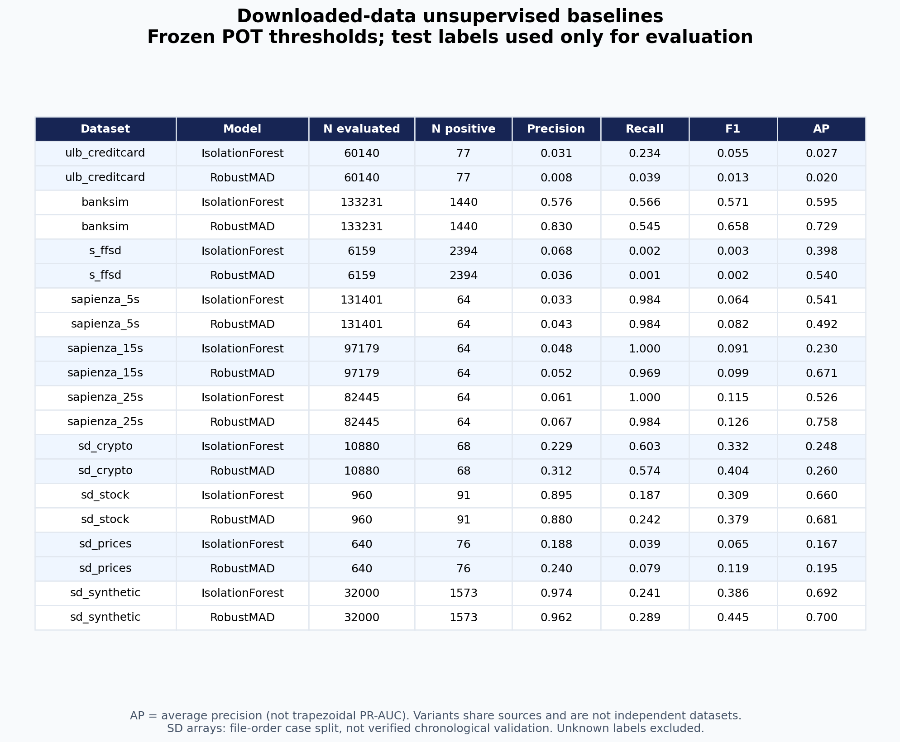
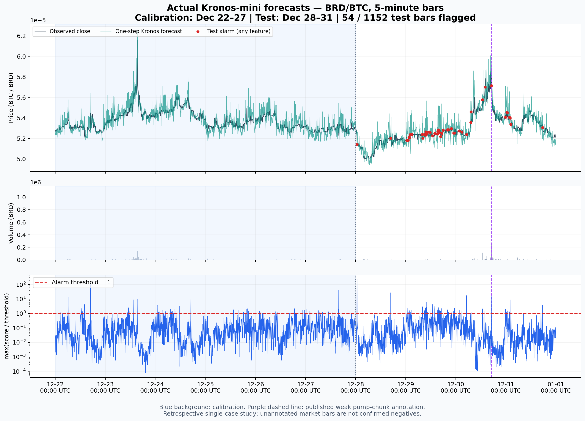

# 金融异常检测实验结果（2026-11-06）

已完成三类实际实验：

- **下载数据基线**：5个数据家族的10个发布版本 × 2种无监督检测器，共20组结果。
- **真实K线Kronos实验**：Kronos-mini 对 BRD/BTC 5分钟真实OHLCVA作滚动单步预测，固定POT阈值检测。
- **授权的Kronos-Proxy实验**：10个非OHLCVA版本的逐特征代理预测，采用固定上限抽样，[单独报告](kronos_proxy/README.md)。

所有表格和图片均从实际推理输出生成，没有用预测桩代替模型，没有手工填写性能数字，没有用测试标签调阈值。运行失败列表为空。该实验不是充分调优后的论文性能基准；真实/合成数据、不同标签粒度、同源派生版本不能合并成一个“总体准确率”。

## 表格及图片

| 产物 | 内容 |
| --- | --- |
| [all_results.csv](all_results.csv) | 31组记录，明确区分20组基线、1个原生Kronos案例和10组抽样Kronos-Proxy实验 |
| [BASELINE_TABLE.md](BASELINE_TABLE.md) / [原始汇总CSV](baselines/summary.csv) | 完整基线数值表 |
| [基线表格图片](baseline_results_table.png) | 可直接阅读或引用的结果表 |
| [基线比较图](baseline_comparison.png) | F1和Average Precision，附随机排序的AP参照 |
| [PR曲线](baseline_precision_recall.png) | 6个代表版本的Precision–Recall曲线 |
| [Kronos时间线](kronos_timeseries.png) | 真实/预测收盘价、成交量、异常分数与告警 |
| [Kronos维度热图](kronos_feature_heatmap.png) | 六维score/threshold，超过1触发该维告警 |
| [Kronos维度统计](kronos/feature_summary.csv) / [图片](kronos_feature_alarms.png) | 每维POT参数、阈值及告警数量 |
| [覆盖范围](coverage.csv) | 8个已下载来源逐项处理情况及新增K线来源 |

上述6幅图片同时提供同名PDF。逐点检测结果在 `baselines/*__detections.csv.gz` 和 [Kronos检测结果](kronos/detections.csv.gz)。前者含测试行ID、原标签、是否可评估、分数、阈值和告警；后者还含真实行情、预测、各维分数和各维告警。基线 `*__details.json` 保存特征列表、划分、POT拟合与混淆矩阵。





## Kronos案例的实测结果

数据为 Binance 官方公开档案 `BRDBTC-5m-2018-12.zip`，使用真实OHLC、base-asset volume和quote-asset volume；amount为真实报价资产成交额，未推算。核对了官方CHECKSUM和5分钟频率连续性。原档案及权重存入本地忽略目录，通过 [prepare脚本](../../scripts/prepare_kronos_case.py) 和 [输入manifest](input_manifest.json) 可按原始SHA256复现，不将行情提供方条款混同为Kronos代码许可。

| 项目 | 实测值/设置 |
| --- | --- |
| 模型 / Tokenizer | NeoQuasar/Kronos-mini / Kronos-Tokenizer-2k，真实预训练权重 |
| 历史窗口 | 64根K线；每次只给当前K线之前的历史 |
| 预测 | 每根单步预测；3次采样均值；T=1，top_p=0.9，top_k=0 |
| 本地推理 | Apple MPS，seed=42，batch_size=32，2880次单步预测 |
| 校准时间 | 2018-12-22 至 2018-12-27，共1728根 |
| 测试时间 | 2018-12-28 至 2018-12-31，共1152根 |
| POT | 每维初始分位数0.90，单维无条件尾部风险0.01，至少30个超额 |
| 评分epsilon | OHLC及amount为1e-8；volume为1e-3，均为原始特征单位 |
| 测试联合告警 | **54/1152（4.6875%）** |
| 校准段联合告警 | 4.1088%，属于拟合样本内诊断 |
| 各维测试告警 | open 17、high 15、low 11、close 19、volume 11、amount 11；存在重叠 |
| 已知事件所在K线 | 2018-12-30 17:00 UTC，触发告警，最大score/threshold约15.68 |

图中的时间是K线**开盘时间**；OHLCVA完整观测须在该K线结束后才能评分，不能据此声称提前发现操纵。

弱标注来自已下载Sapienza 25秒特征发布件中的BRD、pump_index=0，将有观测的chunk按5分钟窗口聚合、对gt取max。测试段有396根可对齐标注，其中仅1根正标注；其余756根保持未知，不当正常。该小子集指标为 precision=0.0625、recall=1.0、F1=0.117647、AP=0.5。**只有一个正事件，不能把100%召回或高ROC-AUC外推为市场总体性能**。gt=0也是上游事件/特征标注，不是监管确认的无操纵证明。完整指标与限定条件见 [summary.json](kronos/summary.json)。

54根告警表示相对预测动态的统计偏离，**不等于54次确诊金融欺诈**。六维取“或”的联合告警概率不同于单维q。校准段假设以正常为主，但未用标签筛选或证明完全正常。数据早于模型训练期，预训练模型可能见过相关行情；这是一项回顾性案例分析，不是严格模型预训练外的时间泛化证据。

## 基线协议与实际表现

固定比较两种方法：

1. Isolation Forest：100棵树、max_samples=256、seed=42、contamination=auto；异常分数为负的 `score_samples`。
2. Robust MAD：对训练参考段拟合逐维median和1.4826×MAD，零MAD回退到训练std，再取平均绝对标准化偏差。零std维度使用尺度1。

所有分类特征只用参考段频率编码，新类别映射为0；数值缺失的填补统计量也只来自参考段。排除标签、时序排序字段及明显恒定邮编。没有用标签清洗参考段或选择模型。两个检测器都在独立校准段使用相同POT配置（u分位数0.90、q=0.01、最小超额数30），随后冻结阈值。

- ULB按完整Time取值、BankSim按完整day、S-FFSD按完整交易序号作约60/20/20划分，不把同一时刻的记录拆入多个集合。S-FFSD的2始终为未知，仅在评估时排除。
- Sapienza三种分辨率均以事件组按最早时间排序划分，跨越边界的事件整组清除，保证参考、校准和测试时间不重叠。上游已发布工程特征的原始归一化/生成过程不在本实验控制内，不能保证其全部前处理满足在线因果性。
- SD-FMM的四组数值数组按完整case的文件顺序作60/20/20划分，不拆开case，不加载6个object字典数组。来源时间和case之间是否复用原始片段无法完全核验，因此不是严格时间外推结果。

完整数值保留在表中。例如，BankSim的Isolation Forest F1为0.5707、Robust MAD为0.6580；ULB两种方法F1仅0.0553和0.0126。S-FFSD的F1更低（约0.0033和0.0016），说明固定阈值在这次划分下效果很弱。不能只引用较好的合成数据结果。AP是 `average_precision_score`，不是梯形积分PR-AUC；随机排序的AP基准取决于测试正例比例。所有指标为这一次固定seed运行，未估计多seed不确定性。

## 未执行检测的已下载内容

| 来源 | 原因 |
| --- | --- |
| SynthAML | 只下载了AlertID、Date、Outcome告警表，缺934.6MB交易表；没有可用的独立交易输入，不能把ID或答案字段做成有意义的欺诈模型 |
| ADMA 2021 | 只有异常事件区间及来源说明，缺相应原始股票行情 |
| CardSim | 是模拟器及公共支付调查输入，不是已生成、有欺诈真值的模拟交易；本次没有人为生成新数据冒充下载数据 |

## 复现

在项目根目录，Python3.10+：

```bash
pip install -e '.[test,experiments,kronos]'
python scripts/download_datasets.py
PYTHONPATH=. python scripts/run_benchmarks.py
python scripts/prepare_kronos_case.py
PYTHONPATH=. python scripts/run_kronos_case.py --device mps
python scripts/plot_results.py
PYTHONPATH=. python scripts/verify_results.py
python -m pytest -q
```

非Apple设备可改 `--device cpu` 或可用的CUDA设备；需选择新的 `--output` 路径，避免复用设备/采样参数不同的缓存。不同设备、PyTorch版本与采样批次不保证逐位一致。缓存附有参数记录，参数不匹配会报错。下载脚本核对已记录模型/Tokenizer及行情字节SHA256，上游文件变化时会失败，不静默替换。

精确依赖版本见 [基线运行记录](baselines/run.json)、[Kronos记录](kronos/summary.json)；当前上游Kronos提交固定为 `67b630e67f6a18c9e9be918d9b4337c960db1e9a`。本实验使用的官方源码、权重和原始行情不重复提交到Git；可用manifest恢复。原始下载输入的SHA256清单见 `data/raw/download_manifest.json`，本次输入manifest还记录其摘要。结果表与逐点分数的一致性可由 `verify_results.py` 离线检查，逐产物摘要保存在 `result_checksums.json`。

测试覆盖标签置换不改变检测分数与阈值、训练段频率编码、完整时间单位划分和未知标签评估等关键约束。

## 数据使用与署名

输入数据的原始许可与出处见 [数据目录](../../data/README.md)。本目录逐点分数、标签及表格属于相应输入数据的派生输出：ULB继续遵守ODbL/DbCL，BankSim遵守CC-BY-NC-SA-4.0，S-FFSD保留原仓库GPL-3.0条件，Sapienza/SD-FMM保留原项目MIT署名；不以统一软件许可覆盖数据权利。绘图只用于展示这些研究结果。新增行情来自 [Binance Public Data](https://github.com/binance/binance-public-data)；Kronos来自 [原作者仓库](https://github.com/shiyu-coder/Kronos)。

## 新增：非OHLCVA数据的Kronos代理适配

用户明确允许逐特征代理表示后，新增[10组Kronos-Proxy实测](kronos_proxy/README.md)。它们使用真实冻结Kronos-mini权重，和本页的20组传统基线、1个原生OHLCVA案例分开命名。本轮每版本最多512个校准点、1024个测试点，保留每组/case预热；不是全量测试。总表新增`experiment_family`与`sampling`列区分实验类别。
