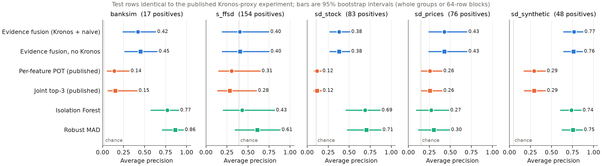
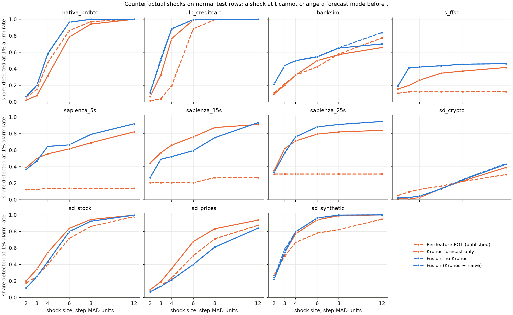
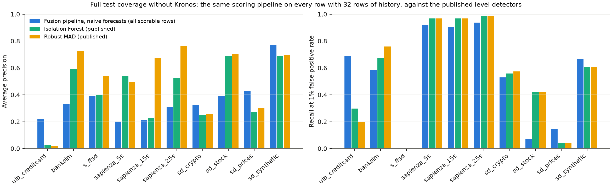
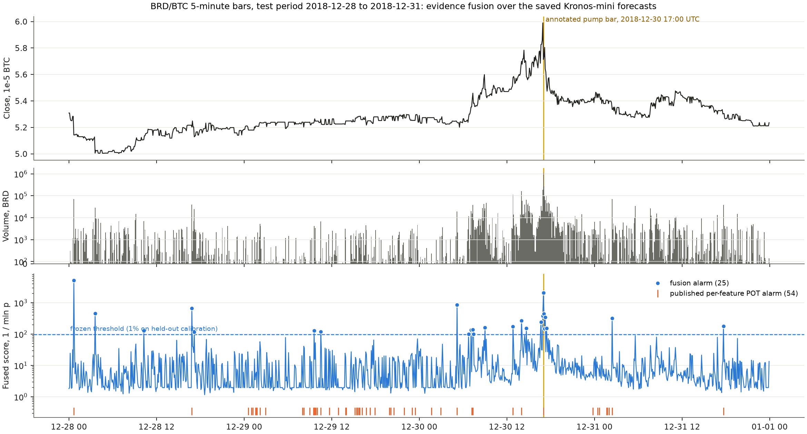

# Kronos 证据融合：冻结协议下的回顾性实验（2026-11-06）

本目录在**不新增任何 Kronos 推理**的前提下，复用仓库已保存的真实 Kronos-mini 预测（原生 BRD/BTC 2,880 根 K 线，以及 10 个代理版本共 126,592 次逐特征预测），重新设计误差评分、校准与阈值，并与已发布结果在**完全相同的测试位置**上比较。协议在首次接触测试行之前冻结，见 [PREREGISTRATION.md](PREREGISTRATION.md)、[frozen_config.json](frozen_config.json) 与 [frozen_manifest.json](frozen_manifest.json)（代码 SHA256）。

## 结论

1. **评分与校准的改造有效。** 在 5 个主要数据集（测试正例 ≥ 5）上，证据融合的 AP 均高于已发布的逐维 POT；配对 bootstrap 95% 区间全部不含 0。相对已发布的联合 top3，4/5 个区间不含 0。1% 名义告警率下的实际告警率落在 0.00%–2.34%，已发布逐维 POT 为 0.39%–21.29%。
2. **Kronos 预测本身没有可测量的贡献。** 同一管线去掉 Kronos、只用“上一值”和“窗口中位数”两种朴素预测，AP 与召回几乎不变（所有配对差异区间都含 0）；L1 最优堆叠给 Kronos 的平均权重为 native_brdbtc 0.20、ulb_creditcard 0.05、banksim 0.03、s_ffsd 0.06、sapienza_5s 0.00、sapienza_15s 0.00、sapienza_25s 0.01、sd_crypto 0.10、sd_stock 0.00、sd_prices 0.00、sd_synthetic 0.20。按各维中位数计，Kronos 一步预测的 MAE 在每个数据集上都高于最好的朴素预测（原生实验的量、额两维是例外，见表 2）。
3. **原生实验的价格预测存在尺度塌缩。** 官方预测器按 (窗口 std + 1e-5) 标准化输入；BRD/BTC 价格约 5e-5，64 根窗口的价格 std 中位数约 2.6e-7，模型实际看到的价格序列有效跨度中位数只有 0.11 个标准化单位，输出再乘回 1e-5 量级的常数，与真实波动无关。校准段内 Kronos 价格 MAE 是“持续预测”的 5–6 倍。`kronos_ad/backend.py` 新增 `prescale`（先按窗口 std 缩放再送入官方预测器，默认开启），有单元测试，但**本轮无权重，无法重跑验证其检测效果**。
4. **水平型基线并未被超越。** Isolation Forest / Robust MAD 在 BankSim、SD-stock 上显著更好（区间不含 0），在 S-FFSD 上 Robust MAD 更好；融合管线在 ULB、SD-crypto、SD-prices、SD-synthetic 上更好（表 4，全覆盖）。预测残差类方法擅长一步突变，不擅长持续抬升的水平型异常。
5. **原生 BRD/BTC：** 融合在 1,152 根测试 K 线上告警 25 次（已发布 54 次），标注 pump K 线在全部测试 K 线中排第 2（已发布第 4），16:55–17:15 形成连续 5 根告警。已发布 54 次告警中有 14 次落在**零成交量**（没有任何成交）的 K 线上且全部只由价格维触发；融合为 0 次。
6. **S-FFSD 上所有预测类方法都只有随机水平**（AP≈正例占比 0.39，AUROC<0.5）；该数据集的“提升”只是从低于随机回到随机，不应视为成功。

## 方法：证据融合

实现见 `kronos_ad/fusion.py`，所有步骤只在拟合分区上估计，阈值只在验证分区上取，测试期间全部冻结：

1. **预测堆叠**：每个特征上，对 {Kronos, 上一值, 窗口中位数} 取 L1 最优凸组合（步长 0.05 的单纯形网格）。没有技能的预测器自动得到接近 0 的权重，退化预测不再主导残差。
2. **条件尺度**：用 0.75 分位 pinball 回归把 |残差| 回归到窗口的 MAD、步长 MAD、std、步长 std 和参考尺度上（系数非负）。波动聚集由数据决定，而不是直接除以窗口 std。
3. **三条证据通道**：`forecast`（一步残差，捕捉起点）、`local`（相对窗口中位数的偏离，异常进入窗口后仍保持）、`global`（相对参考分布的偏离，只对平稳特征开启；SD-FMM 各 case 已被整体 min-max 归一化，故对其关闭）。
4. **保形 p 值 + GPD 尾部**：每个特征-通道的非一致性分数在拟合分区上转换为保形 p 值，超过 0.9 分位后用 Hosking–Wallis 矩估计的 GPD 延伸，使排序在 1/n 之外仍连续；形状参数限制在 [0, 0.75]。
5. **融合**：行分数 = 1 / min p（最强证据），并返回触发的特征与通道用于定位。
6. **一个联合阈值**：验证分区分数的 ⌈(n+1)(1−α)⌉ 次序统计量，α=0.01。逐维“或”随维数膨胀的问题由此消失。
7. **在线阈值（可选）**：自适应保形（Gibbs & Candès 2021）跟踪 1% 告警预算；本轮结果见“事后分析”。

不属于本方法的部分：校准标签用于设计阶段的全局选择（通道组合、尺度项、聚合方式），没有按数据集调参；测试标签只在评估时读取。排除的特征：hour_sin、hour_cos、minute_sin、minute_cos、symbol_reference_frequency（时间编码与品种代码）。

## 协议

- 测试位置、校准位置、拟合/验证二分与 [kronos_tuning](../kronos_tuning/README.md) 完全一致（每版本 ≤512 校准、≤1024 测试，分组保持完整）。原生实验：校准段前半（864 根）拟合、后半验证，1,152 根测试。
- 主要终点：AP 与 1% FPR 下的召回；主要比较：融合 vs 已发布逐维 POT、vs 已发布联合 top3、vs 去掉 Kronos 的同一管线。配对 bootstrap 2,000 次（按整组重采样，单一流按 64 行移动块），seed 20261106。
- 主要数据集（测试正例 ≥ 5）：banksim、s_ffsd、sd_stock、sd_prices、sd_synthetic；其余只作描述。
- 已发布的旧方法测试指标在研究仓库时已被看到，因此测试位置不是严格意义上的“从未接触”；新方法自身的测试结果在冻结前未计算过。
- 冻结之后唯一的改动是补写行级输出文件与验证脚本，`frozen_manifest.json` 中四个文件的 SHA256 至今匹配（`scripts/verify_fusion.py` 检查）。

## 表 1：相同测试位置上的结果

| 数据集 | 正例/已知 | 方法 | AP [95% CI] | R@1%FPR | AUROC | 实际告警率 | F1 |
|---|---:|---|---|---:|---:|---:|---:|
| banksim | 17/1024 | 证据融合（Kronos+朴素） | 0.420 [0.241, 0.630] | 0.176 | 0.969 | 0.78% | 0.240 |
| banksim | 17/1024 | 证据融合（无 Kronos） | 0.451 [0.264, 0.647] | 0.471 | 0.969 | 0.39% | 0.286 |
| banksim | 17/1024 | 逐维 POT（已发布） | 0.137 [0.056, 0.314] | 0.294 | 0.776 | 2.25% | 0.250 |
| banksim | 17/1024 | 联合 top3（已发布） | 0.151 [0.065, 0.408] | 0.235 | 0.882 | 0.39% | 0.095 |
| banksim | 17/1024 | Isolation Forest | 0.770 [0.577, 0.903] | 0.765 | 0.983 | 1.46% | 0.688 |
| banksim | 17/1024 | Robust MAD | 0.863 [0.711, 0.958] | 0.941 | 0.995 | 1.17% | 0.759 |
| s_ffsd | 154/391 | 证据融合（Kronos+朴素） | 0.402 [0.193, 0.746] | 0.006 | 0.324 | 0.00% | 0.000 |
| s_ffsd | 154/391 | 证据融合（无 Kronos） | 0.404 [0.193, 0.748] | 0.006 | 0.325 | 0.00% | 0.000 |
| s_ffsd | 154/391 | 逐维 POT（已发布） | 0.305 [0.149, 0.642] | 0.006 | 0.351 | 2.54% | 0.025 |
| s_ffsd | 154/391 | 联合 top3（已发布） | 0.281 [0.139, 0.599] | 0.000 | 0.222 | 0.39% | 0.000 |
| s_ffsd | 154/391 | Isolation Forest | 0.429 [0.205, 0.813] | 0.000 | 0.610 | 1.17% | 0.000 |
| s_ffsd | 154/391 | Robust MAD | 0.610 [0.348, 0.880] | 0.000 | 0.825 | 1.56% | 0.000 |
| sd_stock | 83/768 | 证据融合（Kronos+朴素） | 0.380 [0.269, 0.505] | 0.072 | 0.822 | 2.34% | 0.198 |
| sd_stock | 83/768 | 证据融合（无 Kronos） | 0.380 [0.269, 0.505] | 0.072 | 0.822 | 2.34% | 0.198 |
| sd_stock | 83/768 | 逐维 POT（已发布） | 0.118 [0.082, 0.162] | 0.012 | 0.554 | 0.39% | 0.000 |
| sd_stock | 83/768 | 联合 top3（已发布） | 0.118 [0.081, 0.164] | 0.012 | 0.551 | 0.26% | 0.000 |
| sd_stock | 83/768 | Isolation Forest | 0.688 [0.461, 0.865] | 0.422 | 0.915 | 2.34% | 0.317 |
| sd_stock | 83/768 | Robust MAD | 0.705 [0.478, 0.876] | 0.422 | 0.930 | 3.12% | 0.393 |
| sd_prices | 76/512 | 证据融合（Kronos+朴素） | 0.427 [0.243, 0.695] | 0.145 | 0.671 | 1.56% | 0.143 |
| sd_prices | 76/512 | 证据融合（无 Kronos） | 0.427 [0.243, 0.695] | 0.145 | 0.671 | 1.56% | 0.143 |
| sd_prices | 76/512 | 逐维 POT（已发布） | 0.257 [0.156, 0.397] | 0.053 | 0.654 | 1.95% | 0.116 |
| sd_prices | 76/512 | 联合 top3（已发布） | 0.258 [0.157, 0.397] | 0.066 | 0.655 | 6.05% | 0.150 |
| sd_prices | 76/512 | Isolation Forest | 0.273 [0.097, 0.479] | 0.039 | 0.584 | 0.59% | 0.076 |
| sd_prices | 76/512 | Robust MAD | 0.302 [0.122, 0.488] | 0.039 | 0.624 | 2.34% | 0.136 |
| sd_synthetic | 48/1024 | 证据融合（Kronos+朴素） | 0.766 [0.646, 0.872] | 0.646 | 0.937 | 1.76% | 0.515 |
| sd_synthetic | 48/1024 | 证据融合（无 Kronos） | 0.761 [0.645, 0.867] | 0.646 | 0.941 | 1.66% | 0.523 |
| sd_synthetic | 48/1024 | 逐维 POT（已发布） | 0.292 [0.174, 0.424] | 0.167 | 0.785 | 1.17% | 0.267 |
| sd_synthetic | 48/1024 | 联合 top3（已发布） | 0.294 [0.176, 0.426] | 0.167 | 0.781 | 0.29% | 0.118 |
| sd_synthetic | 48/1024 | Isolation Forest | 0.738 [0.607, 0.850] | 0.708 | 0.899 | 0.98% | 0.345 |
| sd_synthetic | 48/1024 | Robust MAD | 0.754 [0.626, 0.865] | 0.708 | 0.923 | 1.27% | 0.393 |
| native_brdbtc | 1/396 | 证据融合（Kronos+朴素） | 1.000 | 1.000 | 1.000 | 2.17% | 0.143 |
| native_brdbtc | 1/396 | 证据融合（无 Kronos） | 1.000 | 1.000 | 1.000 | 2.26% | 0.133 |
| native_brdbtc | 1/396 | 逐维 POT（已发布） | 0.500 | 1.000 | 0.997 | 4.69% | 0.118 |
| ulb_creditcard | 3/1024 | 证据融合（Kronos+朴素） | 0.159 | 0.333 | 0.947 | 0.78% | 0.182 |
| ulb_creditcard | 3/1024 | 证据融合（无 Kronos） | 0.158 | 0.333 | 0.932 | 0.78% | 0.182 |
| ulb_creditcard | 3/1024 | 逐维 POT（已发布） | 0.104 | 0.333 | 0.957 | 21.29% | 0.027 |
| ulb_creditcard | 3/1024 | 联合 top3（已发布） | 0.067 | 0.000 | 0.969 | 0.78% | 0.000 |
| ulb_creditcard | 3/1024 | Isolation Forest | 0.077 | 0.333 | 0.974 | 0.78% | 0.000 |
| ulb_creditcard | 3/1024 | Robust MAD | 0.077 | 0.333 | 0.973 | 0.59% | 0.000 |
| sapienza_5s | 0/1024 | 证据融合（Kronos+朴素） | NA | NA | NA | 0.49% | NA |
| sapienza_5s | 0/1024 | 证据融合（无 Kronos） | NA | NA | NA | 0.49% | NA |
| sapienza_5s | 0/1024 | 逐维 POT（已发布） | NA | NA | NA | 5.47% | NA |
| sapienza_5s | 0/1024 | 联合 top3（已发布） | NA | NA | NA | 0.59% | NA |
| sapienza_5s | 0/1024 | Isolation Forest | NA | NA | NA | 1.66% | NA |
| sapienza_5s | 0/1024 | Robust MAD | NA | NA | NA | 1.17% | NA |
| sapienza_15s | 0/1024 | 证据融合（Kronos+朴素） | NA | NA | NA | 0.68% | NA |
| sapienza_15s | 0/1024 | 证据融合（无 Kronos） | NA | NA | NA | 0.68% | NA |
| sapienza_15s | 0/1024 | 逐维 POT（已发布） | NA | NA | NA | 8.40% | NA |
| sapienza_15s | 0/1024 | 联合 top3（已发布） | NA | NA | NA | 0.78% | NA |
| sapienza_15s | 0/1024 | Isolation Forest | NA | NA | NA | 1.17% | NA |
| sapienza_15s | 0/1024 | Robust MAD | NA | NA | NA | 1.56% | NA |
| sapienza_25s | 2/1024 | 证据融合（Kronos+朴素） | 1.000 | 1.000 | 1.000 | 1.17% | 0.286 |
| sapienza_25s | 2/1024 | 证据融合（无 Kronos） | 1.000 | 1.000 | 1.000 | 1.17% | 0.286 |
| sapienza_25s | 2/1024 | 逐维 POT（已发布） | 0.057 | 0.000 | 0.977 | 9.77% | 0.039 |
| sapienza_25s | 2/1024 | 联合 top3（已发布） | 0.750 | 1.000 | 0.999 | 0.78% | 0.400 |
| sapienza_25s | 2/1024 | Isolation Forest | 0.833 | 1.000 | 1.000 | 1.37% | 0.250 |
| sapienza_25s | 2/1024 | Robust MAD | 1.000 | 1.000 | 1.000 | 1.37% | 0.250 |
| sd_crypto | 3/1024 | 证据融合（Kronos+朴素） | 0.112 | 0.333 | 0.985 | 0.88% | 0.000 |
| sd_crypto | 3/1024 | 证据融合（无 Kronos） | 0.108 | 0.333 | 0.984 | 0.88% | 0.000 |
| sd_crypto | 3/1024 | 逐维 POT（已发布） | 0.092 | 0.667 | 0.941 | 1.07% | 0.143 |
| sd_crypto | 3/1024 | 联合 top3（已发布） | 0.101 | 0.667 | 0.951 | 0.29% | 0.000 |
| sd_crypto | 3/1024 | Isolation Forest | 0.300 | 1.000 | 0.996 | 1.95% | 0.261 |
| sd_crypto | 3/1024 | Robust MAD | 0.375 | 1.000 | 0.998 | 1.27% | 0.375 |

配对差异（融合 − 对照，AP，95% bootstrap 区间；正值表示融合更好）：

| 数据集 | vs 逐维 POT | vs 联合 top3 | vs 无 Kronos | vs Isolation Forest | vs Robust MAD |
|---|---|---|---|---|---|
| banksim | **[+0.054, +0.491]** | [-0.042, +0.503] | [-0.077, +0.007] | **[-0.534, -0.105]** | **[-0.571, -0.274]** |
| s_ffsd | **[+0.039, +0.136]** | **[+0.048, +0.184]** | [-0.004, +0.000] | [-0.214, +0.128] | **[-0.262, -0.104]** |
| sd_stock | **[+0.173, +0.363]** | **[+0.175, +0.363]** | [+0.000, +0.000] | **[-0.458, -0.104]** | **[-0.469, -0.111]** |
| sd_prices | **[+0.030, +0.486]** | **[+0.029, +0.486]** | [+0.000, +0.000] | [-0.043, +0.508] | [-0.097, +0.534] |
| sd_synthetic | **[+0.351, +0.590]** | **[+0.351, +0.587]** | [-0.019, +0.028] | [-0.079, +0.143] | [-0.096, +0.127] |



只有 1–3 个正例的 ULB、Sapienza-25s、SD-crypto 和原生 BRD/BTC 不做统计比较；Sapienza-5s/15s 测试子集无正例。
1% FPR 召回：融合在 sd_stock、sd_prices、sd_synthetic 上高于逐维 POT，banksim 上更低，其余持平。

## 表 2：Kronos 一步预测技能（正常行，MAE 比值，<1 表示 Kronos 更好）

| 数据集 | 分区 | 行数 | 维数 | Kronos/上一值 | Kronos/窗口中位数 | Kronos/最优朴素 | Kronos 胜出维数占比 |
|---|---|---:|---:|---:|---:|---:|---:|
| native_brdbtc | calibration | 1663 | 4 | 1.888 | 2.975 | 2.975 | 0.50 |
| native_brdbtc | test | 1151 | 4 | 1.767 | 2.767 | 2.767 | 0.50 |
| ulb_creditcard | calibration | 512 | 29 | 0.952 | 1.304 | 1.304 | 0.00 |
| ulb_creditcard | test | 1021 | 29 | 0.944 | 1.342 | 1.342 | 0.00 |
| banksim | calibration | 507 | 6 | 1.015 | 1.510 | 1.510 | 0.00 |
| banksim | test | 1007 | 6 | 1.023 | 1.431 | 1.431 | 0.00 |
| s_ffsd | calibration | 485 | 5 | 1.113 | 1.179 | 1.179 | 0.00 |
| s_ffsd | test | 870 | 5 | 1.055 | 1.381 | 1.381 | 0.00 |
| sapienza_5s | calibration | 501 | 8 | 1.160 | 1.139 | 1.384 | 0.00 |
| sapienza_5s | test | 1024 | 8 | 1.067 | 1.639 | 1.639 | 0.00 |
| sapienza_15s | calibration | 478 | 8 | 0.995 | 1.583 | 1.583 | 0.00 |
| sapienza_15s | test | 1024 | 8 | 1.233 | 1.571 | 1.571 | 0.00 |
| sapienza_25s | calibration | 480 | 8 | 1.139 | 1.453 | 1.527 | 0.00 |
| sapienza_25s | test | 1022 | 8 | 1.171 | 1.592 | 1.598 | 0.00 |
| sd_crypto | calibration | 501 | 1 | 1.352 | 0.332 | 1.352 | 0.00 |
| sd_crypto | test | 1021 | 1 | 1.333 | 0.294 | 1.333 | 0.00 |
| sd_stock | calibration | 357 | 1 | 1.163 | 1.180 | 1.180 | 0.00 |
| sd_stock | test | 685 | 1 | 1.026 | 0.944 | 1.026 | 0.00 |
| sd_prices | calibration | 246 | 1 | 1.421 | 0.488 | 1.421 | 0.00 |
| sd_prices | test | 436 | 1 | 1.479 | 0.359 | 1.479 | 0.00 |
| sd_synthetic | calibration | 490 | 1 | 1.072 | 0.993 | 1.072 | 0.00 |
| sd_synthetic | test | 976 | 1 | 1.083 | 1.047 | 1.083 | 0.00 |

比值取各维中位数。原生实验用 log 收益、log 高低幅、log1p 成交量、log1p 成交额四个平稳特征；代理实验保留 1 次采样、32 窗口的原设置。

## 表 3：反事实注入功效

在标签为正常的测试行上，把 20% 的维度（至少 1 维）按步长 MAD 的 δ 倍随机正负扰动（3 个种子平均；原生实验改为收益、幅度、量、额同向的 pump 型扰动）。因为 t 时刻的预测只依赖 t 之前的历史，扰动 x_t 不影响预测，可以直接比较评分器。功效 = 扰动后超过该方法自身未扰动分数 99% 分位的比例。

| 数据集 | δ | 逐维 POT | 仅 Kronos | 仅上一值 | 仅中位数 | 堆叠（含 Kronos） | 堆叠（无 Kronos） | 融合 | 融合（无 Kronos） |
|---|---:|---:|---:|---:|---:|---:|---:|---:|---:|
| native_brdbtc | 3 | 0.152 | 0.077 | 0.127 | 0.205 | 0.237 | 0.213 | 0.200 | 0.199 |
| native_brdbtc | 6 | 0.864 | 0.785 | 0.911 | 0.847 | 0.944 | 0.975 | 0.964 | 0.965 |
| ulb_creditcard | 3 | 0.037 | 0.327 | 0.167 | 0.491 | 0.548 | 0.622 | 0.505 | 0.522 |
| ulb_creditcard | 6 | 0.884 | 0.991 | 0.955 | 0.995 | 0.997 | 0.997 | 0.995 | 0.995 |
| banksim | 3 | 0.221 | 0.204 | 0.137 | 0.439 | 0.432 | 0.439 | 0.441 | 0.441 |
| banksim | 6 | 0.424 | 0.499 | 0.346 | 0.545 | 0.532 | 0.541 | 0.544 | 0.548 |
| s_ffsd | 3 | 0.122 | 0.198 | 0.129 | 0.183 | 0.156 | 0.152 | 0.411 | 0.411 |
| s_ffsd | 6 | 0.122 | 0.347 | 0.163 | 0.311 | 0.293 | 0.288 | 0.437 | 0.437 |
| sapienza_5s | 3 | 0.123 | 0.501 | 0.381 | 0.377 | 0.366 | 0.366 | 0.468 | 0.468 |
| sapienza_5s | 6 | 0.138 | 0.615 | 0.549 | 0.632 | 0.535 | 0.535 | 0.664 | 0.664 |
| sapienza_15s | 3 | 0.206 | 0.569 | 0.366 | 0.478 | 0.477 | 0.477 | 0.490 | 0.490 |
| sapienza_15s | 6 | 0.206 | 0.760 | 0.521 | 0.689 | 0.649 | 0.649 | 0.594 | 0.594 |
| sapienza_25s | 3 | 0.311 | 0.620 | 0.683 | 0.530 | 0.701 | 0.701 | 0.569 | 0.569 |
| sapienza_25s | 6 | 0.311 | 0.794 | 0.887 | 0.793 | 0.895 | 0.895 | 0.881 | 0.881 |
| sd_crypto | 3 | 0.094 | 0.012 | 0.012 | 0.033 | 0.013 | 0.012 | 0.026 | 0.026 |
| sd_crypto | 6 | 0.165 | 0.137 | 0.138 | 0.109 | 0.149 | 0.138 | 0.131 | 0.127 |
| sd_stock | 3 | 0.254 | 0.343 | 0.310 | 0.227 | 0.301 | 0.301 | 0.253 | 0.253 |
| sd_stock | 6 | 0.716 | 0.837 | 0.821 | 0.725 | 0.849 | 0.849 | 0.798 | 0.798 |
| sd_prices | 3 | 0.143 | 0.191 | 0.185 | 0.101 | 0.185 | 0.185 | 0.136 | 0.136 |
| sd_prices | 6 | 0.506 | 0.677 | 0.622 | 0.294 | 0.622 | 0.622 | 0.400 | 0.400 |
| sd_synthetic | 3 | 0.504 | 0.549 | 0.532 | 0.514 | 0.610 | 0.603 | 0.545 | 0.584 |
| sd_synthetic | 6 | 0.780 | 0.941 | 0.952 | 0.925 | 0.977 | 0.966 | 0.963 | 0.959 |

δ=3 时融合功效高于已发布逐维 POT 的数据集：8/11；完整 δ∈{2,3,4,6,8,12} 见 injection_power.csv 与下图。“仅 Kronos”并不稳定优于“仅上一值/中位数”。



## 表 4：全覆盖（无 Kronos）对比已发布基线

代理实验只抽样了每版本 ≤1024 个测试位置。去掉 Kronos 后同一管线不需要推理，可以在**每一个拥有 32 行组内历史的测试行**上评分，与已发布的 Isolation Forest / Robust MAD 在相同行上比较（基线分数直接取自已发布 detections 文件）。

| 数据集 | 可评分测试行 / 已发布测试行 | 正例 | 方法 | AP | R@1%FPR | AUROC | 实际告警率 | F1 |
|---|---:|---:|---|---:|---:|---:|---:|---:|
| ulb_creditcard | 60140 / 60140 | 77 | 证据融合（无 Kronos） | 0.223 | 0.688 | 0.947 | 1.04% | 0.151 |
| ulb_creditcard | 60140 / 60140 | 77 | IsolationForest | 0.027 | 0.299 | 0.949 | 0.95% | 0.055 |
| ulb_creditcard | 60140 / 60140 | 77 | RobustMAD | 0.020 | 0.195 | 0.935 | 0.66% | 0.013 |
| banksim | 133231 / 133231 | 1440 | 证据融合（无 Kronos） | 0.335 | 0.585 | 0.970 | 1.34% | 0.438 |
| banksim | 133231 / 133231 | 1440 | IsolationForest | 0.595 | 0.677 | 0.975 | 1.06% | 0.571 |
| banksim | 133231 / 133231 | 1440 | RobustMAD | 0.729 | 0.760 | 0.990 | 0.71% | 0.658 |
| s_ffsd | 15577 / 15577 | 2394 | 证据融合（无 Kronos） | 0.393 | 0.000 | 0.296 | 2.27% | 0.001 |
| s_ffsd | 15577 / 15577 | 2394 | IsolationForest | 0.398 | 0.001 | 0.568 | 1.30% | 0.003 |
| s_ffsd | 15577 / 15577 | 2394 | RobustMAD | 0.540 | 0.000 | 0.763 | 2.18% | 0.002 |
| sapienza_5s | 129347 / 131401 | 64 | 证据融合（无 Kronos） | 0.201 | 0.922 | 0.995 | 1.50% | 0.061 |
| sapienza_5s | 129347 / 131401 | 64 | IsolationForest | 0.542 | 0.969 | 0.998 | 1.44% | 0.065 |
| sapienza_5s | 129347 / 131401 | 64 | RobustMAD | 0.496 | 0.969 | 0.997 | 1.12% | 0.083 |
| sapienza_15s | 95127 / 97179 | 64 | 证据融合（无 Kronos） | 0.215 | 0.906 | 0.997 | 0.70% | 0.158 |
| sapienza_15s | 95127 / 97179 | 64 | IsolationForest | 0.231 | 0.969 | 0.998 | 1.37% | 0.094 |
| sapienza_15s | 95127 / 97179 | 64 | RobustMAD | 0.674 | 0.969 | 0.999 | 1.22% | 0.101 |
| sapienza_25s | 80394 / 82445 | 64 | 证据融合（无 Kronos） | 0.312 | 0.938 | 0.998 | 0.66% | 0.203 |
| sapienza_25s | 80394 / 82445 | 64 | IsolationForest | 0.527 | 0.984 | 0.999 | 1.27% | 0.118 |
| sapienza_25s | 80394 / 82445 | 64 | RobustMAD | 0.766 | 0.984 | 0.999 | 1.13% | 0.129 |
| sd_crypto | 8704 / 10880 | 68 | 证据融合（无 Kronos） | 0.327 | 0.529 | 0.985 | 1.24% | 0.352 |
| sd_crypto | 8704 / 10880 | 68 | IsolationForest | 0.248 | 0.559 | 0.961 | 2.06% | 0.332 |
| sd_crypto | 8704 / 10880 | 68 | RobustMAD | 0.260 | 0.574 | 0.964 | 1.44% | 0.404 |
| sd_stock | 768 / 960 | 83 | 证据融合（无 Kronos） | 0.389 | 0.072 | 0.825 | 0.52% | 0.023 |
| sd_stock | 768 / 960 | 83 | IsolationForest | 0.688 | 0.422 | 0.915 | 2.34% | 0.317 |
| sd_stock | 768 / 960 | 83 | RobustMAD | 0.705 | 0.422 | 0.930 | 3.12% | 0.393 |
| sd_prices | 512 / 640 | 76 | 证据融合（无 Kronos） | 0.427 | 0.145 | 0.671 | 1.56% | 0.143 |
| sd_prices | 512 / 640 | 76 | IsolationForest | 0.273 | 0.039 | 0.584 | 0.59% | 0.076 |
| sd_prices | 512 / 640 | 76 | RobustMAD | 0.302 | 0.039 | 0.624 | 2.34% | 0.136 |
| sd_synthetic | 25600 / 32000 | 1235 | 证据融合（无 Kronos） | 0.770 | 0.666 | 0.954 | 1.09% | 0.366 |
| sd_synthetic | 25600 / 32000 | 1235 | IsolationForest | 0.687 | 0.610 | 0.892 | 1.21% | 0.387 |
| sd_synthetic | 25600 / 32000 | 1235 | RobustMAD | 0.694 | 0.610 | 0.894 | 1.45% | 0.440 |

AP 高于两种基线：；其余数据集基线更好。SD-FMM 的每个 case 都被整体 min–max 归一化到 [0,1]（最大值常常落在标注异常内），水平型检测器因此获得在线场景下不存在的优势；融合管线在这些数据上关闭了 `global` 通道。



## 原生 BRD/BTC 审计

| 项目 | 已发布逐维 POT | 证据融合 |
|---|---:|---:|
| 测试告警 / 1,152 | 54 | 25 |
| 其中只由价格维触发 | 43 | — |
| 落在零成交量 K 线上的告警 | 14 | 0 |
| 标注 pump K 线（2018-12-30 17:00 UTC）是否告警 | 是 | 是 |
| 该 K 线在全部测试 K 线中的分数名次 | 4 | 2 |
| 触发该 K 线的证据 | — | log_amount / global |

零成交量 K 线占测试段 28.9%，这些 K 线没有发生任何成交，价格维告警只能来自退化的预测。堆叠权重（上一值/中位数/Kronos）：log_return [0.0, 1.0, 0.0]；log_range [0.45, 0.55, 0.0]；log_volume [0.25, 0.35, 0.4]；log_amount [0.25, 0.35, 0.4]。



## 事后分析（冻结之后，按预注册规则列出）

**在线阈值步长。** 冻结配置 γ=0.005 取自自适应保形文献，那里的 α 是 0.1。α=0.01 时一次告警使水平下降 0.00495，需要约 100 个安静行才能恢复，期间阈值为 +∞（“失明”）。下表给出不同 γ 的实际告警率与失明行数：

| 数据集 | 固定阈值 | γ=0.005（冻结） | γ=0.001 | γ=0.0005 | γ=0.0001 |
|---|---:|---:|---:|---:|---:|
| native_brdbtc | 2.17% | 0.95%（失明 106） | 1.56%（失明 24） | 2.60%（失明 22） | 3.39%（失明 0） |
| ulb_creditcard | 0.78% | 1.27%（失明 162） | 1.95%（失明 2） | 2.34%（失明 0） | 2.64%（失明 0） |
| banksim | 0.78% | 1.17%（失明 10） | 2.05%（失明 96） | 2.64%（失明 0） | 2.73%（失明 0） |
| s_ffsd | 0.00% | 1.17%（失明 79） | 1.66%（失明 0） | 2.64%（失明 0） | 3.32%（失明 0） |
| sapienza_5s | 0.49% | 1.17%（失明 184） | 1.46%（失明 0） | 2.44%（失明 0） | 2.73%（失明 0） |
| sapienza_15s | 0.68% | 1.17%（失明 189） | 1.86%（失明 0） | 2.05%（失明 0） | 2.83%（失明 0） |
| sapienza_25s | 1.17% | 1.17%（失明 36） | 1.46%（失明 0） | 2.44%（失明 0） | 3.42%（失明 0） |
| sd_crypto | 0.88% | 1.07%（失明 127） | 1.76%（失明 15） | 2.34%（失明 0） | 2.73%（失明 0） |
| sd_stock | 2.34% | 1.30%（失明 57） | 2.34%（失明 22） | 2.99%（失明 0） | 3.78%（失明 0） |
| sd_prices | 1.56% | 1.56%（失明 50） | 1.76%（失明 0） | 1.76%（失明 0） | 1.76%（失明 0） |
| sd_synthetic | 1.76% | 1.17%（失明 114） | 1.86%（失明 11） | 3.03%（失明 37） | 3.71%（失明 0） |

原生 pump K 线：固定阈值告警；γ=0.005 与 0.001 不告警（刚好处于失明期），γ≤0.0005 告警。较小的 γ 消除失明，但在 1,024 行测试内无法把告警率拉回 1%（2–3%）。**结论：在线变体在 α=0.01、千行量级测试下不可用；表 1 的主结果使用固定阈值。** 表 1 中 `_online` 行保留冻结配置的数字。

## 局限

- 没有新的 Kronos 推理：无法测试多次采样、更长上下文、`prescale` 修复或 Kronos-small/base。表 2 的“无技能”结论只对本仓库保存的预测成立（原生：mini、64 窗口、3 次采样、价格尺度塌缩；代理：域外表示、1 次采样、32 窗口）。
- 测试位置已在旧实验中被查看；这是回顾性比较，不是独立前瞻验证。
- 校准标签参与了全局设计选择（通道、尺度项、max 聚合）；没有逐数据集调参，但设计不是完全无监督。
- 主要数据集只有 5 个，正例 17–154 个，区间很宽；Sapienza 三个分辨率、SD 四个版本互相不独立。
- 2,000 次 bootstrap 的块长/分组是预先固定的，不处理序列相关之外的依赖。

## 文件

| 文件 | 内容 |
|---|---|
| metrics.csv / bootstrap.csv | 表 1 及配对区间 |
| `*__rows.csv.gz` | 每个数据集拟合/验证/测试行的分数、阈值、标签，以及测试行上的对照方法分数 |
| forecast_skill.csv | 表 2 |
| injection_power.csv | 表 3（全部 δ 与方法） |
| full_coverage.csv | 表 4 |
| native_rows.csv.gz / native_summary.json | 原生逐 K 线分数、告警、触发特征与通道 |
| stack_weights.json | 各数据集堆叠权重与阈值 |
| posthoc_online_gamma.csv / posthoc_zero_volume_audit.json | 事后分析 |
| frozen_config.json / frozen_manifest.json / PREREGISTRATION.md | 冻结协议 |

## 复现

```bash
pip install -e ".[test,experiments]"
PYTHONPATH=.:scripts python scripts/run_fusion.py
PYTHONPATH=.:scripts python scripts/posthoc_fusion.py
PYTHONPATH=.:scripts python scripts/plot_fusion.py
PYTHONPATH=.:scripts python scripts/report_fusion.py
PYTHONPATH=.:scripts python scripts/verify_fusion.py
python -m pytest -q
```

不需要 Torch 或模型权重；全部输入是仓库内已保存的预测缓存与原始数据。
