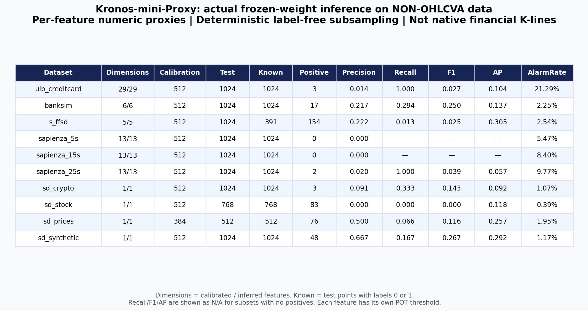

# Kronos-Proxy：非OHLCVA数据的逐特征适配实验

本目录按照用户明确授权，使用**真实冻结的Kronos-mini与Tokenizer权重**，对此前10个非OHLCVA数据版本作逐特征代理序列预测误差检测。不是Isolation Forest、Robust MAD或预测桩，也**不是原生金融K线方法或原论文已验证能力**。

这是**有覆盖上限的抽样适配实验，不是全量检测**。本轮实际评分4,992个校准位置和9,472个测试位置，生成126,592次逐特征单步预测；这些是跨发布版本的计算数量，不代表独立案例数。原生BRD/BTC OHLCVA检测结果仍单独保存在 [原生结果目录](../kronos/summary.json)，原有20组基线不改名、不替换。

## 结果入口

- [结果表CSV](results_table.csv) / [Markdown表](RESULTS_TABLE.md) / [表格PNG](kronos_proxy_table.png)
- [AP和F1图](kronos_proxy_metrics.png)
- [10个版本的异常分数时间线](kronos_proxy_timelines.png)
- [ULB全部29维的异常定位热图](kronos_proxy_ulb_dimensions.png)
- [原生与代理分开汇总](native_vs_proxy.csv)
- [机器可读完整指标](all_metrics.json) / [运行参数及失败记录](run.json)
- `*__detections.csv.gz`：校准/测试各选中位置的原行索引、原标签、预测、原观测、各维分数/阈值/告警、联合告警。
- `*__details.json`：POT参数、特征尺度、实际覆盖行数和指标。
- `*__predictions.npz`、`*__cache_parameters.json`：真实推理预测缓存及参数，用于核验与复现。
- [逐文件摘要与一致性核验](checksums.json)

四组图同时提供PDF。结果中的Dimensions为**成功校准维数/实际推理维数**；任何POT拟合失败维度都会在details里记录，不悄悄替换阈值。



## 代理表示的确切含义

1. 复用既有参考/校准/测试划分及参考段频率编码。所有标签列和时间排序字段都不作为检测特征；类别频率和缺失填补统计量只从参考段计算。
2. 每个特征独立处理。先用参考段median平移、总体std缩放；参考std为零时用1。
3. 把该**代理数值**复制到tokenizer的open/high/low/close四个输入槽；volume和amount槽置零。这里没有产生真实金融价格、成交量或成交额，零值占位槽不参与异常维度诊断。
4. 每条历史窗口再按官方预测器的均值/总体std与`1e-5`处理、仅截断模型历史输入到[-5,5]。直接调用官方`KronosPredictor.generate`，预测一步，读取输出close槽，并反变换到原特征单位。
5. 不截断待评分真实观测。逐维分数为 `((observed-predicted)/(historical_std+epsilon))²`，其中 `epsilon=max(reference_std_used*1e-6,1e-8)`。
6. 只用校准分数拟合逐维POT，测试期间冻结；任一成功校准维度超阈值即联合告警。max_score_ratio为逐维`score/threshold`的最大值，超过或等于1时告警。

这是一种**域外数值表示实验**：模型没有理解PCA维度、支付客户类别或工程特征的原始金融含义，逐特征处理也没有学习这些维度之间的交易关联。代理结果不能直接作为原生Kronos金融异常检测的性能结论。类别维度告警对应的是频率编码偏离，不是已证明的事件原因。

## 固定配置与覆盖范围

| 项目 | 配置 |
| --- | --- |
| 实际模型 | NeoQuasar/Kronos-mini + Kronos-Tokenizer-2k |
| 权重状态 | 冻结预训练权重，没有在标签上训练或微调 |
| 历史窗口 | 32个此前观测；严格不包含当前或未来位置 |
| 采样 | 每条代理序列1次采样，T=1，top_p=0.9，top_k=0 |
| 本地设备 | Apple MPS，float32，seed=42，批大小256 |
| 校准选择 | 每版本最多512个有效点，按位置等距选取，不读取标签 |
| 测试选择 | 每版本最多1024个有效点，按位置等距选取，不读取标签 |
| 阈值 | 每维POT：初始分位数0.90，风险0.01，至少30个超额 |
| 已知标签 | 只在推理和阈值完成后用于评估；S-FFSD的2保持未知 |

参考段用于拟合编码、median和std，没有对冻结Kronos做梯度训练。超过上限的位置本轮未评分，不当作正常。实际行数和异常占比以本目录结果表为准，不能复用此前全测试集统计。

- ULB、BankSim、S-FFSD：沿既有时间/交易序号顺序构造历史。BankSim同一天记录的内部顺序不等于已知的真实交易时钟。
- Sapienza：每个pump event单独重置历史，绝不跨事件拼接；上游工程特征的前处理是否完全在线因果无法由发布件保证。
- SD-FMM：每个case单独重置历史；每段开头不足32点为预热，不能评分。按case文件顺序的既有划分不是经过验证的真实时间外推划分。
- 模型时间戳为从2000-01-01起、按组内位置递增的**人工分钟序号日历**，只为满足模型时间嵌入接口。不声称原交易采样频率为一分钟，时间编码自身可能引入域外偏差。

多个维度取“或”会使联合告警率高于单维风险0.01；报告实际联合告警率，不能把q当成联合误报保证。校准点数量有限，极值尾部估计及单seed随机预测均有不确定性。选中测试子集没有正例或只有一个标签类别时AP/ROC-AUC为空；原始JSON中的precision/recall/F1采用`zero_division=0`约定，不代表具备异常识别证据；面向读者的结果表对零正例子集的Recall/F1/AP显示为空或N/A。

## 与原生Kronos、旧基线的关系

- 原生Kronos实验输入真实OHLCVA；本实验是非OHLCVA代理。两者保持不同模型名称和目录。
- 本轮样本、窗口长度、采样次数及维度组合与旧基线不同，因此不能直接根据两张表的F1宣称谁优于谁。公平比较需要在同一选中位置重跑基线，或在预先固定的完整协议中重新比较。
- 支付欺诈、市场操纵、合成异常和弱标签案例的目标也不同，不能把十个版本合并成独立数据集的平均金融欺诈准确率。

SynthAML当前只有告警ID/日期/审核结果，ADMA当前只有事件区间，CardSim当前为模拟器与公共支付调查输入。没有把答案字段、ID序列或未生成的模拟交易当作新的交易异常基准；这些内容继续在覆盖记录中说明。

## 复现与全量入口

在仓库根目录：

```bash
pip install -e '.[test,experiments,kronos]'
python scripts/download_datasets.py
python scripts/prepare_kronos_case.py
PYTHONPATH=. python scripts/run_kronos_proxy.py
python scripts/plot_kronos_proxy.py
PYTHONPATH=. python scripts/verify_kronos_proxy.py
python -m pytest -q
```

已有预测缓存只有参数和目标位置匹配时才会重用；模型与tokenizer的SHA256以及选中历史窗口、观测、尺度和位置的输入摘要也属于缓存参数。不同设备、批次或PyTorch版本不保证逐位一致。输入来源及原始下载SHA256见 [数据manifest](../../../data/raw/download_manifest.json)，冻结模型及官方源码版本见 [模型输入manifest](../input_manifest.json)。

脚本支持关闭选中位置上限：

```bash
PYTHONPATH=. python scripts/run_kronos_proxy.py \
  --calibration-cap 0 --test-cap 0 \
  --output results/kronos_proxy_full
```

**上述全量命令没有在本轮执行。** 逐特征全量预测量远大于本轮，需另行评估运行时间和存储。全量也仍会排除组开头的预热位置，不会跨case/event制造历史。

## 数据出处与许可

沿用 [原始数据目录](../../../data/README.md) 的数据许可和署名要求；逐点原观测、标签、预测和分数属于对应输入的派生输出，不由统一软件许可覆盖。ULB遵守ODbL/DbCL，BankSim遵守CC-BY-NC-SA-4.0，S-FFSD保留原仓库GPL-3.0条件，Sapienza/SD-FMM保留原项目MIT署名。Kronos与Tokenizer来自原作者公开发布，未在本目录重新分发权重。
