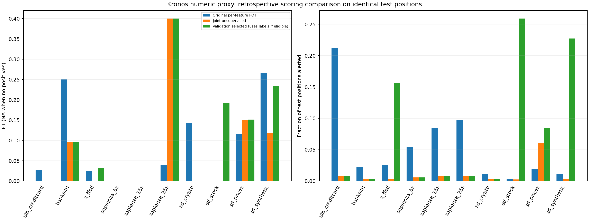

# Kronos 参数与方法调整：回顾性实验

本次复用已保存的真实 Kronos-mini 单步预测，修改误差评分与阈值，不冒充重新训练或新增模型推理。原生 OHLCVA 实验保持不变；以下全部是已授权的逐特征数值代理实验。

## 改动与选参协议

- 残差尺度下限：max(历史窗口标准差, floor × 参考期特征标准差)，防止小分母放大。
- 可选校准残差中位数偏差修正，并用拟合分区的残差中位数平衡特征尺度。
- 将逐维 POT 后取或，改成 max、top3 均值或全维均值的联合分数，再对一个联合分数设置经验次序统计阈值；判定使用严格大于，处理并列分数。
- 原校准位置按时间/文件顺序中点分成前后两部分；事件/案例分组保持完整，跨越中点的分组整体剔除。拟合区最晚位置必须早于验证区最早位置；前半拟合评分统计和阈值，后半作验证。没有重新拟合全部校准集。
- 完全无监督方案固定 floor=0.1、top3、偏差修正、risk=0.01，不使用任何标签。它是本次新增方法；该默认配置不是通过本次测试成绩选择的。
- 验证集选参方案名义搜索 3 floors × 3 聚合 × 2 偏差设置 × 6 risks = 108 配置；校准样本不足以支持对应 risk 的配置明确跳过。仅当验证区有至少3个已知异常和20个已知正常时，按验证 F1、AP、较低报警率等预定顺序选择；否则回退固定无监督配置。此方案使用标签选参，不能称为完全无监督。
- 阈值为排序后第 ceil((n+1)(1-risk)) 项，risk 是名义报警风险；金融序列有相关性，且拟合统计与阈值共享拟合分区，不宣称具有分布无关或严格误报保证。
- 所有配置选择仅访问拟合/验证分区。测试位置与旧实验完全相同，并已在之前实验中查看，因此这里只能做回顾性比较；真正独立验证仍需要新时间段/数据集。
- 512个校准与1024个测试位置为原实验上限；SD 小案例扣除预热后更少，未运行全量数据。窗口32、采样1、T=1、top_p=0.9、冻结模型及输入保持不变。unknown=2 只排除评估、不伪装正常；无正例时 F1/Recall/AP 为 NA。

## 相同测试位置的结果

| Dataset | 方法 | 原 F1 | 新 F1 | 原报警率 | 新报警率 | 验证标签选参 |
|---|---|---:|---:|---:|---:|---|
| ulb_creditcard | joint_unsupervised | 0.0271 | 0.0000 | 21.29% | 0.78% | 否 |
| ulb_creditcard | validation_selected | 0.0271 | 0.0000 | 21.29% | 0.78% | 否 |
| banksim | joint_unsupervised | 0.2500 | 0.0952 | 2.25% | 0.39% | 否 |
| banksim | validation_selected | 0.2500 | 0.0952 | 2.25% | 0.39% | 否 |
| s_ffsd | joint_unsupervised | 0.0245 | 0.0000 | 2.54% | 0.39% | 否 |
| s_ffsd | validation_selected | 0.0245 | 0.0323 | 2.54% | 15.62% | 是 |
| sapienza_5s | joint_unsupervised | NA | NA | 5.47% | 0.59% | 否 |
| sapienza_5s | validation_selected | NA | NA | 5.47% | 0.59% | 否 |
| sapienza_15s | joint_unsupervised | NA | NA | 8.40% | 0.78% | 否 |
| sapienza_15s | validation_selected | NA | NA | 8.40% | 0.78% | 否 |
| sapienza_25s | joint_unsupervised | 0.0392 | 0.4000 | 9.77% | 0.78% | 否 |
| sapienza_25s | validation_selected | 0.0392 | 0.4000 | 9.77% | 0.78% | 否 |
| sd_crypto | joint_unsupervised | 0.1429 | 0.0000 | 1.07% | 0.29% | 否 |
| sd_crypto | validation_selected | 0.1429 | 0.0000 | 1.07% | 0.29% | 否 |
| sd_stock | joint_unsupervised | 0.0000 | 0.0000 | 0.39% | 0.26% | 否 |
| sd_stock | validation_selected | 0.0000 | 0.1915 | 0.39% | 25.91% | 是 |
| sd_prices | joint_unsupervised | 0.1163 | 0.1495 | 1.95% | 6.05% | 否 |
| sd_prices | validation_selected | 0.1163 | 0.1513 | 1.95% | 8.40% | 是 |
| sd_synthetic | joint_unsupervised | 0.2667 | 0.1176 | 1.17% | 0.29% | 否 |
| sd_synthetic | validation_selected | 0.2667 | 0.2349 | 1.17% | 22.75% | 是 |

改进不保证每个数据集都成立；完整 Precision/Recall/AP、混淆矩阵与配置见 comparison.csv、all_metrics.json 和 validation_search.csv。无监督方案在 Sapienza-25s、SD-prices 的 F1 提升，但 ULB、BankSim、S-FFSD、SD-crypto、SD-synthetic 的召回/F1 下降，不建议全局替换原方案。验证选参方案在 SD-stock、SD-prices 提升 F1，但伴随较高报警率，且 SD-synthetic 仍退步。以上结论应与正例数量一起理解，Sapienza-25s 测试仅2个正例。不同采样版本不视为独立语料；固定阈值可能无法适应分布切换。代理方法存在领域偏移，不能替代原生行情有效性验证。

复现前安装 `pip install -e ".[test,experiments,kronos]"`，保留仓库内原始数据与已发布的 Kronos-Proxy 预测缓存。运行 `PYTHONPATH=.:scripts python scripts/tune_kronos_proxy.py`；验证：`PYTHONPATH=.:scripts python scripts/verify_kronos_tuning.py`。评分重放不需要重新下载模型权重。输入预测哈希见 input_manifest.json；完整结果不覆盖原始实验。
