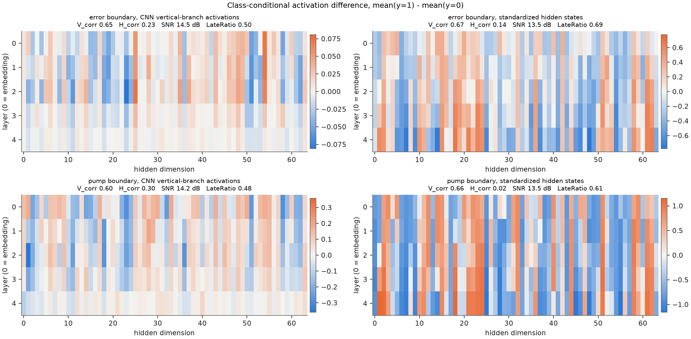
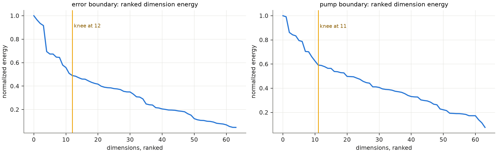
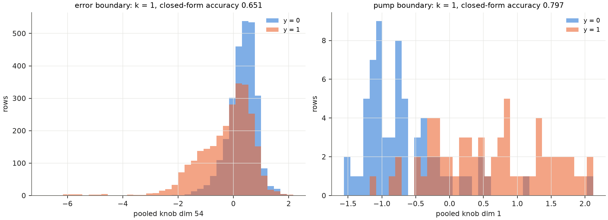
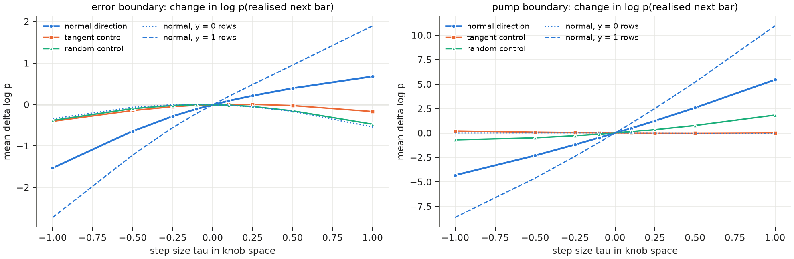

# 知识边界分析：替身 Transformer（无 Kronos 权重）

论文流程（探针 → 结构定位 → knob 搜索 → 闭式蒸馏 → 定向干预）在一个**替身**模型上的端到端运行：在 `sapienza_15s` 的参考分区上训练的因果 Transformer（4 层、$d=64$、4 头、上下文 32 根、240075 个训练窗口、3 个 epoch，高斯下一根 K 线预测头）。隐状态 $H$ 为嵌入输出与每个块输出在最后一根 K 线处的残差流（5 层 × 64 维）。**所有数字只描述这个替身模型，不代表 Kronos。** 换成真实 Kronos 只需换隐状态适配器（`scripts/run_boundary_kronos.py`）。

特征：std_rush_order、avg_rush_order、std_trades、std_volume、avg_volume、std_price、avg_price、avg_price_max。探针在参考+校准行的平衡子集上拟合，在测试行的平衡子集上评估；预测器只见过参考行。

训练曲线：epoch 1 训练 NLL 0.584，校准段末步 NLL 5.408；epoch 2 训练 NLL -0.012，校准段末步 NLL 5.079；epoch 3 训练 NLL -0.146，校准段末步 NLL 5.206；选用校准段 NLL 最低的 epoch 2。持续预测 + 校准段方差的基线 NLL 5.584。误差边界阈值（校准段正常行 NLL 90 分位）4.150。

## 结论

替身模型：校准段末步 NLL 5.08（选用 epoch 2），优于“持续预测 + 校准段方差”的 5.58；它是一个真实训练出来的、有预测技能的小 Transformer，但不是 Kronos。

1. **两种边界都能从隐状态学到，但比 LLM 弱。** 误差边界（“模型不知道这根 K 线”）平衡精度 0.65–0.68，pump 边界 0.77–0.82；论文在 LLM 上为 0.69–0.81。线性探针在这里不比多视角 CNN 差，说明边界在 5×64 的隐状态里近似线性。
2. **证据沿深度组织，沿维度稀疏——与论文的 RQ2 定性一致。** 两种边界的 $V_{corr}$ 0.60–0.67 远大于 $H_{corr}$ 0.02–0.30；SNR 13.5–14.5 dB；标准化隐状态的能量拐点在 64 维中的第 5（误差）/43（pump）维，CNN 激活图上为 12/11；后半层占比 0.61–0.69（标准化隐状态），CNN 图上约 0.5。
3. **knob 很小，但“近优”的判据在这里很弱。** 两种边界的嵌套搜索都在 $k=1$ 停下（维 54、维 1），因为 CNN 探针恰好是最弱的探针：相对线性探针，top-1 并未达到 1% 容差，top-$k$ 要到 $k\approx7$–8 才追上。随机单维有 8%（误差）/ 14%（pump）的概率不低于 top-1，论文是 0%。结论：这个替身的边界比 LLM 的更分散；论文“两个维度即可”的结果不能照搬。
4. **定向干预是因果的，而且机制可读。** 沿法向走 $\tau$，真实下一根 K 线的对数似然变化远大于切向与随机对照（Wilcoxon $p\approx0$，仅误差边界 $\tau=+0.1$ 对切向不显著）。分解到高斯头的两项：误差 knob 的法向**抬高预测方差**（$\tau=0.1$ 时 Σ log σ² 变化 +0.08）并把均值推向意外的 K 线（误差项 −0.26），因此对 $y=1$ 行提高似然、对 $y=0$ 行降低似然；pump knob 的法向几乎只移动均值（误差项 −1.0，方差项 +0.005），对正常行几乎无影响（−0.003）、对 pump 行 +0.99。也就是说，“不知道”方向控制的是模型的不确定度，“pump”方向控制的是对尖峰的预期。注意 $k=1$ 时切向对照退化为零向量，随机对照等于随机符号的法向，只能当幅度参照；$k\ge2$ 的对照才有论文的含义。
5. **作为异常分数，隐状态信号不如模型输出的意外度。** 在全部 24,040 个抽样测试行（64 个 pump）上，黑箱 NLL 意外度 AP 0.60、AUROC 0.995、R@1%FPR 0.84；三种隐状态分数 AP 0.05–0.14、AUROC 0.79–0.89。探针是在平衡集上以分类精度训练的，对极端尾部的排序能力差。在这个替身上，边界分析是**解释工具**（定位“模型不确定”的方向并验证其因果作用），不是更好的检测器；要作为检测证据进入融合，需要按排序目标训练或直接用 $\Phi$ 的保形校准。
6. **对 Kronos 意味着什么。** Kronos 是离散 token 模型，似然是 $(s_1^*,s_2^*)$ 的 token 似然；隐状态更宽更深。本目录只证明流程在真实金融 Transformer 上可运行并给出可解释的结果，表 1–5 的每个数字都需要在真实权重上重测（`scripts/run_boundary_kronos.py`）。

## 表 1：边界可学性（平衡精度，机会水平 0.5）

| 边界 | 训练行（正例） | 测试行（正例） | LR | MLP | 多视角 CNN |
|---|---:|---:|---:|---:|---:|
| error | 4832（2416） | 5398（2699） | 0.677 | 0.670 | 0.651 |
| pump | 506（253） | 128（64） | 0.820 | 0.812 | 0.766 |

## 表 2：边界证据的结构（附录 B 统计量）

| 边界 | 激活图 | V_corr（跨层连续） | H_corr（跨维连续） | SNR (dB) | LateRatio（后半层占比） | 能量拐点（维数） |
|---|---|---:|---:|---:|---:|---:|
| error | CNN 纵向支路 | 0.65 | 0.23 | 14.5 | 0.50 | 12 |
| error | 标准化隐状态 | 0.67 | 0.14 | 13.5 | 0.69 | 5 |
| pump | CNN 纵向支路 | 0.60 | 0.30 | 14.2 | 0.48 | 11 |
| pump | 标准化隐状态 | 0.66 | 0.02 | 13.5 | 0.61 | 43 |

## 表 3：knob 搜索（嵌套 top-k，δ = 1%，对照为同样大小的随机子集）

| 边界 | 全维 CNN 精度 | k | 维度 | top-k 精度 | 是否达到 1% 容差 | 随机子集精度 均值 / 最小 / 最大 | 随机 ≥ top-k 的比例 | 闭式精度 |
|---|---:|---:|---|---:|---|---|---:|---:|
| error | 0.651 | 1 | [54] | 0.651 | 是 | 0.608 / 0.562 / 0.671 | 0.08 | 0.651 |
| pump | 0.766 | 1 | [1] | 0.797 | 是 | 0.738 / 0.641 / 0.805 | 0.14 | 0.797 |

top-k 精度随 k 的变化：
- error：k=1 0.651，k=2 0.662，k=3 0.672，k=4 0.680，k=5 0.679，k=6 0.681，k=7 0.682，k=8 0.679，k=9 0.680，k=10 0.679
- pump：k=1 0.797，k=2 0.812，k=3 0.797，k=4 0.828，k=5 0.828，k=6 0.828，k=7 0.820，k=8 0.836，k=9 0.820，k=10 0.812

闭式边界分数（log 原语库，池化坐标已标准化）：

- error：`Phi = +0.750 -1.451*log(2.400 +1.367*x1) +0.919*log(1.685 -0.273*x1)`；层注意力 α = [0.124, 0.077, 0.331, 0.109, 0.36]
- pump：`Phi = -0.008 +1.420*log(1.854 +1.088*x1) -0.798*log(2.531 -1.931*x1)`；层注意力 α = [0.004, 0.003, 0.002, 0.007, 0.985]

## 表 4：定向干预（式 7–11）

沿闭式边界的法向以步长 τ 扰动 knob 坐标，按 α 分摊到各层最后位置；度量为真实下一根 K 线对数似然的平均变化；对照为切向与随机方向；p 值为 Wilcoxon 符号秩检验（法向 vs 0、法向 vs 切向、法向 vs 随机）。y=0 / y=1 列是法向效应在两类测试行上的分别均值。

| 边界 | τ | 法向 Δlog p | 中位数 | 改善比例 | y=0 | y=1 | 切向 | 随机 | p(法向≠0) | p(法向 vs 切向) | p(法向 vs 随机) | Δ预测对数方差（法向） |
|---|---:|---:|---:|---:|---:|---:|---:|---:|---:|---:|---:|---:|
| error | -1.00 | -1.5306 | -0.3210 | 26.9% | -0.3388 | -2.7224 | -0.4020 | -0.3786 | 0.0e+00 | 0.0e+00 | 7.1e-02 | -0.585 |
| error | -0.50 | -0.6403 | -0.0657 | 38.1% | -0.0625 | -1.2181 | -0.1415 | -0.0953 | 0.0e+00 | 0.0e+00 | 7.8e-01 | -0.350 |
| error | -0.25 | -0.2793 | -0.0077 | 46.8% | -0.0031 | -0.5555 | -0.0501 | -0.0189 | 0.0e+00 | 2.3e-33 | 4.6e-01 | -0.187 |
| error | -0.10 | -0.1025 | +0.0013 | 51.6% | +0.0056 | -0.2106 | -0.0149 | +0.0001 | 7.1e-20 | 8.2e-11 | 5.6e-01 | -0.077 |
| error | +0.10 | +0.0921 | -0.0070 | 43.2% | -0.0147 | +0.1989 | +0.0080 | -0.0104 | 3.2e-01 | 8.6e-01 | 3.6e-01 | +0.077 |
| error | +0.25 | +0.2155 | -0.0287 | 40.1% | -0.0534 | +0.4843 | +0.0079 | -0.0449 | 3.1e-05 | 2.1e-05 | 4.2e-01 | +0.193 |
| error | +0.50 | +0.3960 | -0.0928 | 35.7% | -0.1619 | +0.9538 | -0.0228 | -0.1490 | 3.3e-29 | 8.3e-21 | 1.5e-01 | +0.379 |
| error | +1.00 | +0.6804 | -0.3030 | 30.8% | -0.5392 | +1.8999 | -0.1665 | -0.4716 | 0.0e+00 | 0.0e+00 | 2.5e-02 | +0.737 |
| pump | -1.00 | -4.3144 | -0.1757 | 18.8% | -0.0026 | -8.6263 | +0.2007 | -0.7069 | 1.4e-15 | 2.9e-15 | 2.1e-05 | -0.048 |
| pump | -0.50 | -2.3061 | -0.0810 | 22.7% | +0.0054 | -4.6177 | +0.0738 | -0.4983 | 1.7e-13 | 2.6e-13 | 1.0e-05 | -0.024 |
| pump | -0.25 | -1.1896 | -0.0388 | 23.4% | +0.0044 | -2.3836 | +0.0303 | -0.2852 | 1.5e-12 | 2.9e-12 | 1.1e-05 | -0.012 |
| pump | -0.10 | -0.4846 | -0.0148 | 28.9% | +0.0022 | -0.9713 | +0.0105 | -0.1227 | 8.5e-12 | 1.6e-11 | 3.7e-06 | -0.005 |
| pump | +0.10 | +0.4960 | +0.0135 | 69.5% | -0.0027 | +0.9947 | -0.0084 | +0.1342 | 4.2e-11 | 1.2e-10 | 2.9e-06 | +0.005 |
| pump | +0.25 | +1.2613 | +0.0327 | 68.0% | -0.0077 | +2.5304 | -0.0171 | +0.3569 | 1.7e-10 | 6.4e-10 | 5.9e-06 | +0.012 |
| pump | +0.50 | +2.5927 | +0.0598 | 66.4% | -0.0189 | +5.2043 | -0.0212 | +0.7849 | 1.5e-09 | 7.4e-09 | 1.8e-05 | +0.025 |
| pump | +1.00 | +5.4585 | +0.0935 | 60.9% | -0.0513 | +10.9682 | +0.0096 | +1.8509 | 3.5e-08 | 3.6e-07 | 2.8e-05 | +0.050 |

## 表 5：内部信号作为异常分数（全部抽样测试行，标注异常为正例）

| 边界 | 分数 | 测试行 | 正例 | AP | AUROC | R@1%FPR |
|---|---|---:|---:|---:|---:|---:|
| error | nll_surprise | 24040 | 64 | 0.597 | 0.995 | 0.844 |
| error | cnn_probe | 24040 | 64 | 0.120 | 0.789 | 0.375 |
| error | logistic_probe | 24040 | 64 | 0.139 | 0.831 | 0.375 |
| error | knob_closed_form | 24040 | 64 | 0.106 | 0.797 | 0.359 |
| pump | nll_surprise | 24040 | 64 | 0.597 | 0.995 | 0.844 |
| pump | cnn_probe | 24040 | 64 | 0.083 | 0.875 | 0.359 |
| pump | logistic_probe | 24040 | 64 | 0.098 | 0.875 | 0.359 |
| pump | knob_closed_form | 24040 | 64 | 0.045 | 0.893 | 0.297 |

`nll_surprise` 是黑箱基线（模型输出的意外度）；`cnn_probe` / `logistic_probe` / `knob_closed_form` 是隐状态信号。误差边界的探针没有用任何异常标签。

## 文件

| 文件 | 内容 |
|---|---|
| results.json | 全部数字 |
| intervention.csv / anomaly_detection.csv | 表 4、表 5 |
| `*_delta_cnn.npy` / `*_delta_raw.npy` | 差分图 |
| `*_knob_space.npz` | 测试行的池化 knob 坐标、标签、闭式分数 |
| run.log | 运行日志 |
