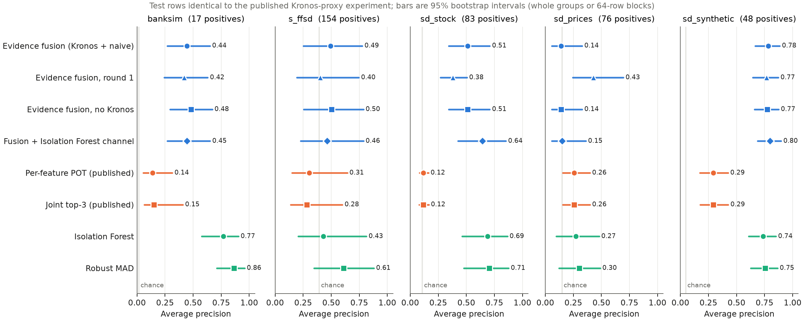
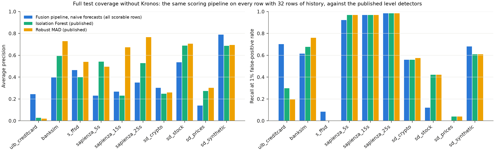
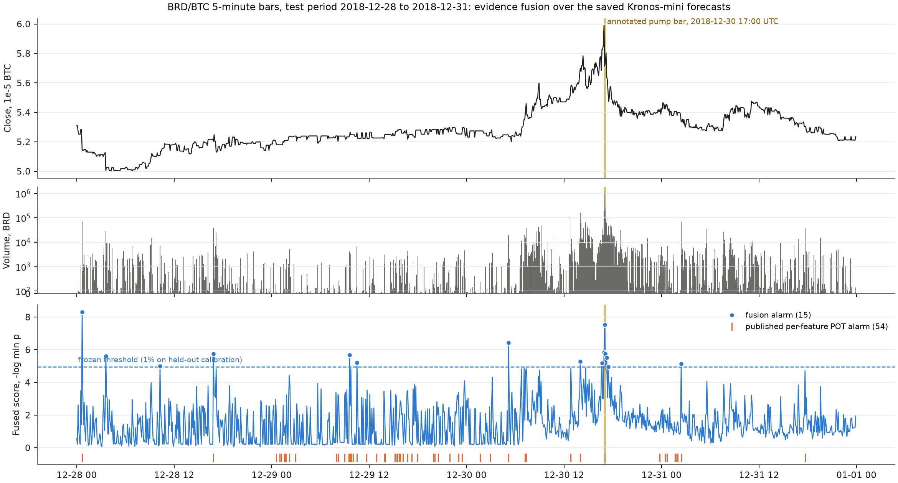

# Kronos 证据融合：第 2 轮（2026-11-07，冻结协议下的第二次测试评估）

在第 1 轮（[results/2026-11-06/kronos_fusion](../../2026-11-06/kronos_fusion/README.md)）之后，本轮只在**校准行**上设计（14 个配置，见 [dev_full.csv](dev_full.csv) 与 [dev_ladder.csv](dev_ladder.csv)），按 [PREREGISTRATION.md](PREREGISTRATION.md) 预先写下的规则选出配置并冻结（[frozen_config.json](frozen_config.json)、[frozen_manifest.json](frozen_manifest.json)），然后在**与第 1 轮完全相同的测试行**上评估一次。本轮有两次测试查看：纯方法与集成臂。仍然没有新的 Kronos 推理。

## 第 2 轮改了什么

1. **`long` 通道**：相对同组内最多 512 行因果历史（严格早于当前行）的中位数的偏离，尺度为该历史的 IQR/1.349 加入条件尺度模型。32 行窗口在异常区间中会被污染，长历史保持灵敏。
2. **多统计量聚合**：对每个通道以及全部活跃证据分别计算 Tippett（−min log p）与 Fisher（−Σ log p）统计量，各自在拟合分区上做保形校准，取最强的校准统计量作为行分数。第 1 轮只取单个最强证据，分散在多个特征上的中等证据被忽略。
3. 其余不变：预测堆叠、pinball 条件尺度、GPD 尾部保形 p 值、验证分区上的单一联合阈值（α=0.01）、排除时间/品种编码、SD 数据关闭 `global`。

在校准行上尝试但**未被选中**的部分（数字见 dev_full.csv）：按预测技能的通道门控（BankSim 上有利、ULB 上不利）、双侧秩稀有度（BankSim 上显著变差）、时间/品种编码进入 `global`（无影响）、幅度型统计量 meanz/maxz（BankSim 上达到 Robust MAD 水平，但 ULB 与 Sapienza 上崩溃）。

## 结论

1. **相对第 1 轮：** 在 5 个主要数据集上，第 2 轮 AP 高于第 1 轮的有 4 个（banksim、s_ffsd、sd_stock、sd_synthetic），配对 bootstrap 区间不含 0 的有 3 个（s_ffsd、sd_stock、sd_synthetic）；显著变差的有 1 个（sd_prices）。
2. **相对已发布方法：** AP 高于已发布逐维 POT 的主要数据集 4/5，区间不含 0 的 4/5。1% 名义告警率下的实际告警率：除 sd_prices（21.29%，见结论 6）外为 0.00%–1.76%。
3. **Kronos 仍无正向贡献：** 去掉 Kronos 后的 AP 配对差异区间，2 个为负（Kronos 有害：banksim、s_ffsd），0 个为正，其余含 0（banksim **[-0.087, -0.000]**、s_ffsd **[-0.018, -0.001]**、sd_stock [+0.000, +0.000]、sd_prices [+0.000, +0.000]、sd_synthetic [-0.010, +0.030]）。BankSim 上 1% FPR 召回 0.176（有 Kronos）对 0.471（无）。堆叠平均权重：native_brdbtc 0.20、ulb_creditcard 0.05、banksim 0.03、s_ffsd 0.06、sapienza_5s 0.00、sapienza_15s 0.00、sapienza_25s 0.01、sd_crypto 0.10、sd_stock 0.00、sd_prices 0.00、sd_synthetic 0.20。
4. **集成臂：** 加入 Isolation Forest 行证据后，AP 高于纯方法的主要数据集 4/5；相对 Isolation Forest 单独使用，配对差异区间：banksim **[-0.484, -0.107]**、s_ffsd [-0.108, +0.123]、sd_stock **[-0.077, -0.005]**、sd_prices **[-0.174, -0.023]**、sd_synthetic [-0.023, +0.156]。
5. **原生 BRD/BTC：** 第 2 轮 15 次告警（第 1 轮 25，已发布 54），pump K 线名次 2（第 1 轮 2），零成交量 K 线上的告警 0 次（已发布 14）。
6. **sd_prices 退化：** AP 从第 1 轮的 0.427 降到 0.140，实际告警率 21.29%。该数据集只有 16 个 case，校准段 3 个：拟合分区是**单个** case（128 行，步长 MAD 为 0 的阶梯状序列），验证分区是另一个 case，4 个测试 case 的波动完全不同。多统计量的二级校准在 128 行上外推失效，而第 1 轮的单一最强证据恰好更耐受。这是数据量低于方法要求的失败，按预注册规则如实报告，不做事后修补；第 3 轮应加入“拟合分区少于 2 个组或少于 N 行时退回 max 聚合”的守卫并在校准行上验证。
7. **注入功效下降：** δ=3 时第 2 轮功效高于第 1 轮的数据集只有 5/11；Sapienza 与 S-FFSD 上明显更低（表 2）。更多通道与统计量稀释了对单点冲击的灵敏度，这是换取水平型异常灵敏度的代价。

## 表 1：相同测试位置上的结果

| 数据集 | 正例/已知 | 方法 | AP [95% CI] | R@1%FPR | AUROC | 实际告警率 | F1 |
|---|---:|---|---|---:|---:|---:|---:|
| banksim | 17/1024 | 第 2 轮证据融合 | 0.445 [0.269, 0.649] | 0.176 | 0.975 | 0.20% | 0.211 |
| banksim | 17/1024 | 第 1 轮证据融合 | 0.420 [0.241, 0.630] | 0.176 | 0.969 | 0.78% | 0.240 |
| banksim | 17/1024 | 第 2 轮（无 Kronos） | 0.481 [0.294, 0.670] | 0.471 | 0.976 | 0.20% | 0.211 |
| banksim | 17/1024 | 集成臂（+Isolation Forest 行证据） | 0.445 [0.269, 0.650] | 0.176 | 0.972 | 0.20% | 0.211 |
| banksim | 17/1024 | 逐维 POT（已发布） | 0.137 [0.056, 0.314] | 0.294 | 0.776 | 2.25% | 0.250 |
| banksim | 17/1024 | 联合 top3（已发布） | 0.151 [0.065, 0.408] | 0.235 | 0.882 | 0.39% | 0.095 |
| banksim | 17/1024 | Isolation Forest | 0.770 [0.577, 0.903] | 0.765 | 0.983 | 1.46% | 0.688 |
| banksim | 17/1024 | Robust MAD | 0.863 [0.711, 0.958] | 0.941 | 0.995 | 1.17% | 0.759 |
| s_ffsd | 154/391 | 第 2 轮证据融合 | 0.493 [0.253, 0.776] | 0.084 | 0.588 | 0.00% | 0.000 |
| s_ffsd | 154/391 | 第 1 轮证据融合 | 0.402 [0.193, 0.746] | 0.006 | 0.324 | 0.00% | 0.000 |
| s_ffsd | 154/391 | 第 2 轮（无 Kronos） | 0.503 [0.256, 0.787] | 0.084 | 0.592 | 0.00% | 0.000 |
| s_ffsd | 154/391 | 集成臂（+Isolation Forest 行证据） | 0.465 [0.228, 0.786] | 0.084 | 0.539 | 0.00% | 0.000 |
| s_ffsd | 154/391 | 逐维 POT（已发布） | 0.305 [0.149, 0.642] | 0.006 | 0.351 | 2.54% | 0.025 |
| s_ffsd | 154/391 | 联合 top3（已发布） | 0.281 [0.139, 0.599] | 0.000 | 0.222 | 0.39% | 0.000 |
| s_ffsd | 154/391 | Isolation Forest | 0.429 [0.205, 0.813] | 0.000 | 0.610 | 1.17% | 0.000 |
| s_ffsd | 154/391 | Robust MAD | 0.610 [0.348, 0.880] | 0.000 | 0.825 | 1.56% | 0.000 |
| sd_stock | 83/768 | 第 2 轮证据融合 | 0.511 [0.343, 0.709] | 0.145 | 0.863 | 0.26% | 0.024 |
| sd_stock | 83/768 | 第 1 轮证据融合 | 0.380 [0.269, 0.505] | 0.072 | 0.822 | 2.34% | 0.198 |
| sd_stock | 83/768 | 第 2 轮（无 Kronos） | 0.511 [0.343, 0.709] | 0.145 | 0.863 | 0.26% | 0.024 |
| sd_stock | 83/768 | 集成臂（+Isolation Forest 行证据） | 0.644 [0.425, 0.852] | 0.253 | 0.918 | 0.39% | 0.047 |
| sd_stock | 83/768 | 逐维 POT（已发布） | 0.118 [0.082, 0.162] | 0.012 | 0.554 | 0.39% | 0.000 |
| sd_stock | 83/768 | 联合 top3（已发布） | 0.118 [0.081, 0.164] | 0.012 | 0.551 | 0.26% | 0.000 |
| sd_stock | 83/768 | Isolation Forest | 0.688 [0.461, 0.865] | 0.422 | 0.915 | 2.34% | 0.317 |
| sd_stock | 83/768 | Robust MAD | 0.705 [0.478, 0.876] | 0.422 | 0.930 | 3.12% | 0.393 |
| sd_prices | 76/512 | 第 2 轮证据融合 | 0.140 [0.057, 0.328] | 0.000 | 0.492 | 21.29% | 0.065 |
| sd_prices | 76/512 | 第 1 轮证据融合 | 0.427 [0.243, 0.695] | 0.145 | 0.671 | 1.56% | 0.143 |
| sd_prices | 76/512 | 第 2 轮（无 Kronos） | 0.140 [0.057, 0.328] | 0.000 | 0.492 | 21.29% | 0.065 |
| sd_prices | 76/512 | 集成臂（+Isolation Forest 行证据） | 0.151 [0.057, 0.361] | 0.000 | 0.538 | 21.29% | 0.065 |
| sd_prices | 76/512 | 逐维 POT（已发布） | 0.257 [0.156, 0.397] | 0.053 | 0.654 | 1.95% | 0.116 |
| sd_prices | 76/512 | 联合 top3（已发布） | 0.258 [0.157, 0.397] | 0.066 | 0.655 | 6.05% | 0.150 |
| sd_prices | 76/512 | Isolation Forest | 0.273 [0.097, 0.479] | 0.039 | 0.584 | 0.59% | 0.076 |
| sd_prices | 76/512 | Robust MAD | 0.302 [0.122, 0.488] | 0.039 | 0.624 | 2.34% | 0.136 |
| sd_synthetic | 48/1024 | 第 2 轮证据融合 | 0.784 [0.668, 0.885] | 0.625 | 0.944 | 1.76% | 0.515 |
| sd_synthetic | 48/1024 | 第 1 轮证据融合 | 0.766 [0.646, 0.872] | 0.646 | 0.937 | 1.76% | 0.515 |
| sd_synthetic | 48/1024 | 第 2 轮（无 Kronos） | 0.774 [0.659, 0.875] | 0.625 | 0.947 | 1.46% | 0.476 |
| sd_synthetic | 48/1024 | 集成臂（+Isolation Forest 行证据） | 0.799 [0.688, 0.897] | 0.625 | 0.947 | 1.76% | 0.545 |
| sd_synthetic | 48/1024 | 逐维 POT（已发布） | 0.292 [0.174, 0.424] | 0.167 | 0.785 | 1.17% | 0.267 |
| sd_synthetic | 48/1024 | 联合 top3（已发布） | 0.294 [0.176, 0.426] | 0.167 | 0.781 | 0.29% | 0.118 |
| sd_synthetic | 48/1024 | Isolation Forest | 0.738 [0.607, 0.850] | 0.708 | 0.899 | 0.98% | 0.345 |
| sd_synthetic | 48/1024 | Robust MAD | 0.754 [0.626, 0.865] | 0.708 | 0.923 | 1.27% | 0.393 |
| native_brdbtc | 1/396 | 第 2 轮证据融合 | 1.000 | 1.000 | 1.000 | 1.30% | 0.286 |
| native_brdbtc | 1/396 | 第 1 轮证据融合 | 1.000 | 1.000 | 1.000 | 2.17% | 0.143 |
| native_brdbtc | 1/396 | 第 2 轮（无 Kronos） | 1.000 | 1.000 | 1.000 | 1.30% | 0.286 |
| native_brdbtc | 1/396 | 集成臂（+Isolation Forest 行证据） | 1.000 | 1.000 | 1.000 | 1.48% | 0.250 |
| native_brdbtc | 1/396 | 逐维 POT（已发布） | 0.500 | 1.000 | 0.997 | 4.69% | 0.118 |
| ulb_creditcard | 3/1024 | 第 2 轮证据融合 | 0.242 | 0.667 | 0.959 | 0.88% | 0.167 |
| ulb_creditcard | 3/1024 | 第 1 轮证据融合 | 0.159 | 0.333 | 0.947 | 0.78% | 0.182 |
| ulb_creditcard | 3/1024 | 第 2 轮（无 Kronos） | 0.242 | 0.667 | 0.960 | 0.78% | 0.182 |
| ulb_creditcard | 3/1024 | 集成臂（+Isolation Forest 行证据） | 0.242 | 0.667 | 0.959 | 0.88% | 0.167 |
| ulb_creditcard | 3/1024 | 逐维 POT（已发布） | 0.104 | 0.333 | 0.957 | 21.29% | 0.027 |
| ulb_creditcard | 3/1024 | 联合 top3（已发布） | 0.067 | 0.000 | 0.969 | 0.78% | 0.000 |
| ulb_creditcard | 3/1024 | Isolation Forest | 0.077 | 0.333 | 0.974 | 0.78% | 0.000 |
| ulb_creditcard | 3/1024 | Robust MAD | 0.077 | 0.333 | 0.973 | 0.59% | 0.000 |
| sapienza_5s | 0/1024 | 第 2 轮证据融合 | NA | NA | NA | 0.49% | NA |
| sapienza_5s | 0/1024 | 第 1 轮证据融合 | NA | NA | NA | 0.49% | NA |
| sapienza_5s | 0/1024 | 第 2 轮（无 Kronos） | NA | NA | NA | 0.49% | NA |
| sapienza_5s | 0/1024 | 集成臂（+Isolation Forest 行证据） | NA | NA | NA | 0.49% | NA |
| sapienza_5s | 0/1024 | 逐维 POT（已发布） | NA | NA | NA | 5.47% | NA |
| sapienza_5s | 0/1024 | 联合 top3（已发布） | NA | NA | NA | 0.59% | NA |
| sapienza_5s | 0/1024 | Isolation Forest | NA | NA | NA | 1.66% | NA |
| sapienza_5s | 0/1024 | Robust MAD | NA | NA | NA | 1.17% | NA |
| sapienza_15s | 0/1024 | 第 2 轮证据融合 | NA | NA | NA | 1.27% | NA |
| sapienza_15s | 0/1024 | 第 1 轮证据融合 | NA | NA | NA | 0.68% | NA |
| sapienza_15s | 0/1024 | 第 2 轮（无 Kronos） | NA | NA | NA | 1.27% | NA |
| sapienza_15s | 0/1024 | 集成臂（+Isolation Forest 行证据） | NA | NA | NA | 1.27% | NA |
| sapienza_15s | 0/1024 | 逐维 POT（已发布） | NA | NA | NA | 8.40% | NA |
| sapienza_15s | 0/1024 | 联合 top3（已发布） | NA | NA | NA | 0.78% | NA |
| sapienza_15s | 0/1024 | Isolation Forest | NA | NA | NA | 1.17% | NA |
| sapienza_15s | 0/1024 | Robust MAD | NA | NA | NA | 1.56% | NA |
| sapienza_25s | 2/1024 | 第 2 轮证据融合 | 1.000 | 1.000 | 1.000 | 1.37% | 0.250 |
| sapienza_25s | 2/1024 | 第 1 轮证据融合 | 1.000 | 1.000 | 1.000 | 1.17% | 0.286 |
| sapienza_25s | 2/1024 | 第 2 轮（无 Kronos） | 1.000 | 1.000 | 1.000 | 1.37% | 0.250 |
| sapienza_25s | 2/1024 | 集成臂（+Isolation Forest 行证据） | 1.000 | 1.000 | 1.000 | 1.37% | 0.250 |
| sapienza_25s | 2/1024 | 逐维 POT（已发布） | 0.057 | 0.000 | 0.977 | 9.77% | 0.039 |
| sapienza_25s | 2/1024 | 联合 top3（已发布） | 0.750 | 1.000 | 0.999 | 0.78% | 0.400 |
| sapienza_25s | 2/1024 | Isolation Forest | 0.833 | 1.000 | 1.000 | 1.37% | 0.250 |
| sapienza_25s | 2/1024 | Robust MAD | 1.000 | 1.000 | 1.000 | 1.37% | 0.250 |
| sd_crypto | 3/1024 | 第 2 轮证据融合 | 0.127 | 0.333 | 0.987 | 0.98% | 0.154 |
| sd_crypto | 3/1024 | 第 1 轮证据融合 | 0.112 | 0.333 | 0.985 | 0.88% | 0.000 |
| sd_crypto | 3/1024 | 第 2 轮（无 Kronos） | 0.125 | 0.333 | 0.987 | 0.98% | 0.154 |
| sd_crypto | 3/1024 | 集成臂（+Isolation Forest 行证据） | 0.200 | 0.000 | 0.991 | 1.46% | 0.333 |
| sd_crypto | 3/1024 | 逐维 POT（已发布） | 0.092 | 0.667 | 0.941 | 1.07% | 0.143 |
| sd_crypto | 3/1024 | 联合 top3（已发布） | 0.101 | 0.667 | 0.951 | 0.29% | 0.000 |
| sd_crypto | 3/1024 | Isolation Forest | 0.300 | 1.000 | 0.996 | 1.95% | 0.261 |
| sd_crypto | 3/1024 | Robust MAD | 0.375 | 1.000 | 0.998 | 1.27% | 0.375 |

配对差异（第 2 轮 − 对照，AP，95% bootstrap 区间；正值表示第 2 轮更好；“单元”为重采样单元数，少于 10 的区间不可靠）：

| 数据集 | 单元 | vs 第 1 轮 | vs 逐维 POT | vs 联合 top3 | vs 无 Kronos | vs Isolation Forest | vs Robust MAD |
|---|---:|---|---|---|---|---|---|
| banksim | 16 | [-0.005, +0.070] | **[+0.067, +0.517]** | [-0.025, +0.514] | **[-0.087, -0.000]** | **[-0.485, -0.103]** | **[-0.542, -0.265]** |
| s_ffsd | 7 | **[+0.005, +0.156]** | **[+0.085, +0.238]** | **[+0.096, +0.273]** | **[-0.018, -0.001]** | [-0.134, +0.193] | **[-0.218, -0.016]** |
| sd_stock | 6 | **[+0.027, +0.240]** | **[+0.241, +0.567]** | **[+0.241, +0.565]** | [+0.000, +0.000] | **[-0.289, -0.066]** | **[-0.300, -0.075]** |
| sd_prices | 4 | **[-0.544, -0.101]** | [-0.154, +0.010] | [-0.154, +0.010] | [+0.000, +0.000] | **[-0.207, -0.044]** | **[-0.267, -0.024]** |
| sd_synthetic | 200 | **[+0.003, +0.035]** | **[+0.367, +0.605]** | **[+0.365, +0.604]** | [-0.010, +0.030] | [-0.052, +0.156] | [-0.069, +0.138] |

1% FPR 召回的配对差异（第 2 轮 − 第 1 轮）：banksim [+0.000, +0.095]、s_ffsd [-0.014, +0.143]、sd_stock [-0.058, +0.183]、sd_prices **[-0.364, -0.049]**、sd_synthetic [-0.091, +0.061]。

集成臂的配对差异（集成 − 对照，AP）：

| 数据集 | vs 第 2 轮纯方法 | vs Isolation Forest | vs Robust MAD |
|---|---|---|---|
| banksim | [-0.010, +0.010] | **[-0.484, -0.107]** | **[-0.539, -0.267]** |
| s_ffsd | [-0.096, +0.051] | [-0.108, +0.123] | [-0.296, +0.012] |
| sd_stock | **[+0.043, +0.223]** | **[-0.077, -0.005]** | **[-0.098, -0.008]** |
| sd_prices | [-0.000, +0.037] | **[-0.174, -0.023]** | **[-0.257, -0.022]** |
| sd_synthetic | [-0.012, +0.044] | [-0.023, +0.156] | [-0.040, +0.140] |



## 表 2：反事实注入功效（δ=3 与 6，1% 告警率）

| 数据集 | δ | 第 2 轮 | 第 1 轮 | 第 2 轮无 Kronos | 集成臂 | 逐维 POT |
|---|---:|---:|---:|---:|---:|---:|
| native_brdbtc | 3 | 0.227 | 0.200 | 0.240 | 0.203 | 0.152 |
| native_brdbtc | 6 | 0.931 | 0.964 | 0.938 | 0.921 | 0.864 |
| ulb_creditcard | 3 | 0.543 | 0.505 | 0.547 | 0.543 | 0.037 |
| ulb_creditcard | 6 | 0.996 | 0.995 | 0.996 | 0.996 | 0.884 |
| banksim | 3 | 0.442 | 0.441 | 0.442 | 0.442 | 0.221 |
| banksim | 6 | 0.544 | 0.544 | 0.548 | 0.544 | 0.424 |
| s_ffsd | 3 | 0.288 | 0.411 | 0.288 | 0.288 | 0.122 |
| s_ffsd | 6 | 0.423 | 0.437 | 0.423 | 0.423 | 0.122 |
| sapienza_5s | 3 | 0.258 | 0.468 | 0.258 | 0.258 | 0.123 |
| sapienza_5s | 6 | 0.652 | 0.664 | 0.652 | 0.652 | 0.138 |
| sapienza_15s | 3 | 0.472 | 0.490 | 0.472 | 0.472 | 0.206 |
| sapienza_15s | 6 | 0.566 | 0.594 | 0.566 | 0.566 | 0.206 |
| sapienza_25s | 3 | 0.391 | 0.569 | 0.391 | 0.391 | 0.311 |
| sapienza_25s | 6 | 0.833 | 0.881 | 0.833 | 0.833 | 0.311 |
| sd_crypto | 3 | 0.040 | 0.026 | 0.040 | 0.012 | 0.094 |
| sd_crypto | 6 | 0.120 | 0.131 | 0.119 | 0.018 | 0.165 |
| sd_stock | 3 | 0.259 | 0.253 | 0.259 | 0.194 | 0.254 |
| sd_stock | 6 | 0.799 | 0.798 | 0.799 | 0.700 | 0.716 |
| sd_prices | 3 | 0.008 | 0.136 | 0.008 | 0.008 | 0.143 |
| sd_prices | 6 | 0.057 | 0.401 | 0.057 | 0.057 | 0.506 |
| sd_synthetic | 3 | 0.512 | 0.545 | 0.550 | 0.497 | 0.504 |
| sd_synthetic | 6 | 0.960 | 0.963 | 0.956 | 0.968 | 0.780 |

δ=3 时第 2 轮功效高于第 1 轮的数据集 5/11，高于已发布逐维 POT 的 9/11。注入只扰动序列特征，协议与第 1 轮相同。

## 表 3：全覆盖（无 Kronos）

| 数据集 | 可评分测试行 | 正例 | 第 2 轮管线 AP | 第 1 轮管线 AP | Isolation Forest | Robust MAD | 第 2 轮 R@1% | 第 1 轮 R@1% |
|---|---:|---:|---:|---:|---:|---:|---:|---:|
| ulb_creditcard | 60140 | 77 | 0.244 | 0.223 | 0.027 | 0.020 | 0.701 | 0.688 |
| banksim | 133231 | 1440 | 0.397 | 0.335 | 0.595 | 0.729 | 0.615 | 0.585 |
| s_ffsd | 15577 | 2394 | 0.465 | 0.393 | 0.398 | 0.540 | 0.084 | 0.000 |
| sapienza_5s | 129347 | 64 | 0.230 | 0.201 | 0.542 | 0.496 | 0.922 | 0.922 |
| sapienza_15s | 95127 | 64 | 0.267 | 0.215 | 0.231 | 0.674 | 0.969 | 0.906 |
| sapienza_25s | 80394 | 64 | 0.351 | 0.312 | 0.527 | 0.766 | 0.984 | 0.938 |
| sd_crypto | 8704 | 68 | 0.302 | 0.327 | 0.248 | 0.260 | 0.559 | 0.529 |
| sd_stock | 768 | 83 | 0.536 | 0.389 | 0.688 | 0.705 | 0.120 | 0.072 |
| sd_prices | 512 | 76 | 0.140 | 0.427 | 0.273 | 0.302 | 0.000 | 0.145 |
| sd_synthetic | 25600 | 1235 | 0.789 | 0.770 | 0.687 | 0.694 | 0.681 | 0.666 |

全覆盖 AP 高于第 1 轮管线的数据集：ulb_creditcard、banksim、s_ffsd、sapienza_5s、sapienza_15s、sapienza_25s、sd_stock、sd_synthetic。



## 原生 BRD/BTC

| 项目 | 已发布逐维 POT | 第 1 轮 | 第 2 轮 |
|---|---:|---:|---:|
| 测试告警 / 1,152 | 54 | 25 | 15 |
| 零成交量 K 线上的告警 | 14 | 0 | 0 |
| pump K 线是否告警 | 是 | 是 | 是 |
| pump K 线名次 | 4 | 2 | 2 |
| 触发证据 | — | log_amount/global | log_amount/global |



## 设计阶段：校准行上的阶梯（dev_full.csv，AP）

每个数据集的拟合分区为校准段前半、评估为后半（分组保持完整），管线不含 Kronos。

| 数据集 | 评估正例 | C0 round1 | C1 +long | C1 +multi | C2 +gate | C3 +multi | C4 +rank | C7 gate+long+multi4 | C10 C7 magnitude only | C6 +iforest | C11 C1+multi+iforest |
|---|---:|---:|---:|---:|---:|---:|---:|---:|---:|---:|---:|
| banksim | 714 | 0.349 | 0.336 | 0.405 | 0.511 | 0.530 | 0.227 | 0.595 | 0.728 | 0.427 | 0.415 |
| s_ffsd | 289 | 0.115 | 0.168 | 0.141 | 0.172 | 0.139 | 0.151 | 0.131 | 0.098 | 0.148 | 0.145 |
| sapienza_15s | 25 | 0.202 | 0.202 | 0.298 | 0.199 | 0.217 | 0.215 | 0.244 | 0.251 | 0.244 | 0.297 |
| sapienza_25s | 25 | 0.244 | 0.211 | 0.279 | 0.222 | 0.558 | 0.194 | 0.174 | 0.136 | 0.532 | 0.279 |
| sapienza_5s | 25 | 0.282 | 0.282 | 0.340 | 0.284 | 0.318 | 0.280 | 0.313 | 0.322 | 0.333 | 0.340 |
| sd_crypto | 33 | 0.475 | 0.462 | 0.477 | 0.462 | 0.477 | 0.462 | 0.461 | 0.462 | 0.450 | 0.450 |
| sd_prices | 10 | 0.957 | 0.950 | 0.950 | 0.950 | 0.950 | 0.950 | 0.950 | 0.950 | 0.950 | 0.950 |
| sd_stock | 61 | 0.464 | 0.421 | 0.425 | 0.421 | 0.425 | 0.421 | 0.423 | 0.421 | 0.487 | 0.487 |
| sd_synthetic | 661 | 0.761 | 0.783 | 0.782 | 0.783 | 0.782 | 0.783 | 0.782 | 0.783 | 0.794 | 0.794 |
| ulb_creditcard | 34 | 0.148 | 0.158 | 0.139 | 0.170 | 0.095 | 0.077 | 0.073 | 0.012 | 0.070 | 0.139 |

选中 `C1 +multi`（本轮配置）。

## 冻结后改动

无。`scripts/verify_fusion.py r2` 核对 frozen_manifest.json 中全部文件的 SHA256 与各表的重算值。

## 局限

- 两次测试查看（纯方法、集成臂）叠加在第 1 轮之上；本轮的区间没有为多次查看校正。
- 设计集与测试集来自不同时段：S-FFSD 的校准段上任何方法都接近随机（Robust MAD AP 0.16），测试段上 Robust MAD 达到 0.61，因此校准段上的选择对该数据集没有指导意义。
- ULB（34 个评估正例）与 Sapienza（25 个 pump，三个分辨率共享）的设计集很小。
- 仍无新的 Kronos 推理；Kronos 侧的所有结论只对仓库保存的预测成立。
- SD 数据的 `global` 通道按协议关闭，水平型基线利用了逐 case 的 min–max 归一化。

## 文件

| 文件 | 内容 |
|---|---|
| metrics.csv / bootstrap.csv / posthoc_ensemble_bootstrap.csv | 表 1 及配对区间 |
| `*__rows.csv.gz` | 行级分数、阈值、标签，测试行上的全部对照分数 |
| forecast_skill.csv / injection_power.csv / full_coverage.csv | 表 2、表 3 与预测技能 |
| native_rows.csv.gz / native_summary.json / posthoc_* | 原生审计与事后分析 |
| dev_full.csv / dev_ladder.csv | 设计阶段全部配置的校准行结果 |
| frozen_config.json / frozen_manifest.json / PREREGISTRATION.md | 冻结协议 |

## 复现

```bash
PYTHONPATH=.:scripts python scripts/dev_full_r2.py        # 设计阶段（校准行）
PYTHONPATH=.:scripts python scripts/run_fusion.py --round r2
PYTHONPATH=.:scripts python scripts/posthoc_fusion.py r2
PYTHONPATH=.:scripts python scripts/posthoc_round2.py
PYTHONPATH=.:scripts python scripts/plot_fusion.py r2
PYTHONPATH=.:scripts python scripts/report_round2.py
PYTHONPATH=.:scripts python scripts/verify_fusion.py r2
```
